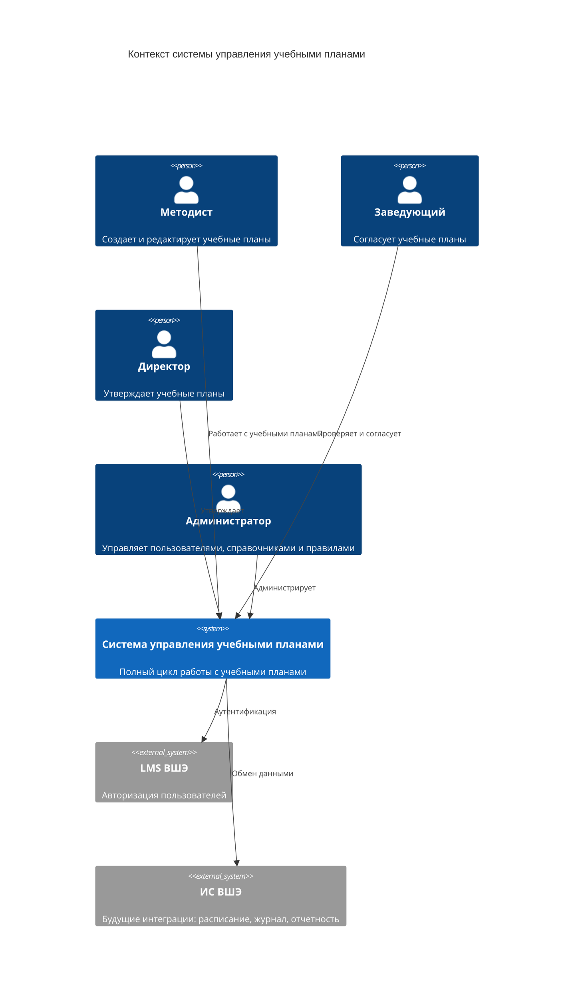
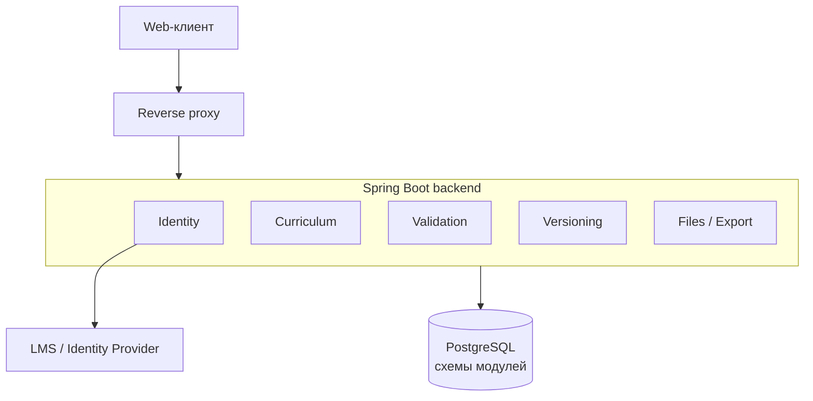
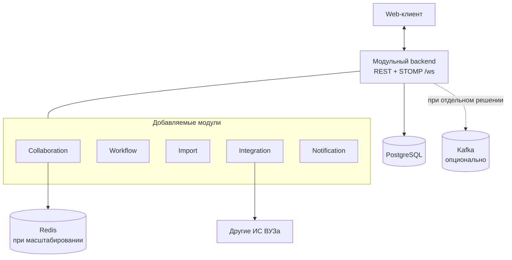

# Системный дизайн

## Цель документа

Документ описывает верхнеуровневую архитектуру системы управления учебными планами в виде модульного монолита на Java/Spring. MVP включает модули Identity, Curriculum, Validation, Versioning и ограниченную функцию экспорта; Collaboration, Import, Workflow и расширенные Integration/Notification capabilities вводятся в post-MVP релизах.

## Архитектурный стиль

Для архитектуры выбран модульный монолит. Backend развертывается как одно Spring Boot приложение, а бизнес-возможности разделены на модули с собственными моделями и владельцами данных.

Модули реализуются как package-based Spring Modulith modules в одном backend build и взаимодействуют через публичные application API и события. Прямой доступ к внутренним пакетам, repository и таблицам другого модуля запрещен; зависимости контролируются Spring Modulith и ArchUnit. Внешние API не раскрывают внутреннюю упаковку приложения.

Для MVP применяются функциональные упрощения: версии создаются вручную и проверяются синхронно, валидация рабочей ревизии запускается по кнопке, экспорт ограничен одним форматом, массовые операции отсутствуют. Выделение модуля в отдельный сервис рассматривается при появлении независимого профиля масштабирования, цикла поставки, требований изоляции или отдельной команды-владельца.

## Технологический ориентир

### Backend

- Java 21.
- Spring Boot.
- Spring Web для REST API.
- Spring WebSocket и STOMP для real-time взаимодействия.
- Spring Security для аутентификации и авторизации.
- Spring Data JPA для работы с реляционными БД.
- Spring Modulith и ArchUnit для контроля границ модулей.
- Изоляция domain, application и infrastructure слоев внутри каждого бизнес-модуля.

### Frontend

- Web-приложение как основной клиент MVP.
- API проектируется независимо от web-клиента, чтобы позднее подключить мобильное приложение.

### Данные

- PostgreSQL как основное реляционное хранилище.
- Redis для краткоживущего состояния real-time сессий, блокировок, presence-информации и кеширования.
- Импортируемые файлы обрабатываются во временном каталоге backend и удаляются сразу после разбора; долговременно хранится только нормализованный staging JSON и метаданные.
- Экспорт формируется синхронно и передается клиенту потоковым HTTP-ответом без сохранения бинарного артефакта.
- MinIO рассматривается только как возможное расширение при появлении требований к долговременному хранению объектов.
- Внутрипроцессные application events для слабосвязанных взаимодействий модулей.
- Apache Kafka рассматривается как кандидат для будущей межпроцессной доставки и не входит в обязательную инфраструктуру MVP или post-MVP.

### Интеграции

- LMS ВШЭ как внешний провайдер идентификации.
- Остальные информационные системы ВШЭ подключаются через интеграционный слой.

### Развертывание

- Backend и web-клиент поставляются как отдельные неизменяемые OCI/Docker-образы.
- Контейнеры запускаются от непривилегированного пользователя и не хранят постоянное состояние локально.
- Конфигурация и секреты поступают из среды развертывания без пересборки образа.
- Конкретная платформа виртуализации и оркестрации не фиксируется до обследования инфраструктуры ВУЗа.
- Пользовательский доступ к reverse proxy разрешен только из внутренней сети или через корпоративный VPN.

## Capacity planning

Исходные объемы пока не предоставлены, поэтому архитектура не использует непроверенные оценки для обоснования масштабирования. До пилота должны быть зафиксированы:

| Параметр | Текущее состояние |
|---|---|
| число зарегистрированных и активных пользователей | открыто |
| пиковое число одновременных сессий | открыто |
| число учебных планов и прирост в год | открыто |
| среднее и максимальное число сущностей в плане | открыто |
| частота изменений, проверок, версий и экспортов | открыто |
| объем snapshot-версий и срок их хранения | открыто |
| частота и размер импортов Post-MVP 1 | лимит одного файла 50 MiB; поток открыт |

Начальная топология с одним экземпляром backend является функциональной, а не расчетной конфигурацией высокой доступности. После получения исходных значений выполняется оценка peak RPS, storage growth, Kafka throughput для использующих Kafka сценариев и WebSocket concurrency для нагрузки `1x` и `10x`; результаты уточняют resource limits, необходимость горизонтального масштабирования и целесообразность выделения отдельных модулей.

## Контекст системы

## Контейнерная схема MVP

Backend отправляет telemetry в общий observability stack; связь не показана отдельной стрелкой, чтобы не перегружать схему.

## Расширение контейнерной схемы Post-MVP

Kafka не используется для обычных внутрипроцессных вызовов и не считается обязательной частью расширения. Ее добавление вместе с transactional outbox требует перевода ADR-0008 и ADR-0011 в `accepted` для конкретного межпроцессного сценария.

## Модули и зоны ответственности

### Edge и API

Reverse proxy является единой сетевой точкой входа для web-клиента и будущих мобильных клиентов. Backend предоставляет единый внешний API.

Отвечает за:

- TLS termination и маршрутизацию к backend;
- проверку токенов на границе;
- rate limiting;
- добавление correlation id;
- унификацию внешней версии API.

### Identity

Отвечает за аутентификацию, связь с LMS ВШЭ и внутреннюю модель пользователей.

Основные сущности:

- пользователь;
- роль;
- право доступа;
- организационная принадлежность;
- связь внешней учетной записи LMS с внутренним пользователем.

Модуль Identity взаимодействует с LMS/Identity Provider напрямую: выполняет protocol adapter, связывает внешний `subject` с `user_id` и формирует authorization context. Модуль Integration не участвует во входе пользователя и не является зависимостью authentication path.

### Curriculum

Основной доменный модуль учебных планов.

Отвечает за:

- направления подготовки;
- учебные планы;
- блоки дисциплин;
- дисциплины;
- учебные модули: четыре модуля на учебный год;
- часы и зачетные единицы;
- формы контроля;
- пререквизиты;
- состояние редактируемого плана.

Этот модуль является источником истины для текущего состояния учебного плана.

### Collaboration

Отвечает за совместное редактирование в реальном времени.

Функции:

- WebSocket-соединения;
- presence: кто сейчас редактирует план;
- доставка операций другим пользователям;
- обнаружение конфликтов версий сущностей.

Начиная с Post-MVP 1 модуль Collaboration поддерживает presence и live-доставку структурированных изменений без курсоров и выделения ячеек. Конфликты предотвращаются оптимистической блокировкой по ревизии изменяемой сущности.

При разрыве WebSocket web-клиент отключает presence и пытается переподключиться. После reconnect он сначала получает актуальную ревизию и состояние через REST, затем применяет новые STOMP events. Периодический polling без WebSocket не входит в текущую реализацию.

Collaboration не должен становиться владельцем состояния плана. Он координирует real-time взаимодействие, а постоянное состояние сохраняется через публичный API модуля Curriculum.

### Versioning

Отвечает за сохранение версий учебных планов.

Для MVP используется snapshot-based подход: версия содержит снимок учебного плана на момент явного сохранения пользователем.

В MVP snapshot сохраняется и проверяется синхронно фиксированным набором правил. В Post-MVP 1 snapshot сохраняется независимо от выполнения Validation, а проверка запускается асинхронно после commit; Versioning хранит технический статус проверки и агрегированный результат.

Функции:

- создать версию;
- получить список версий;
- сравнить версии;
- восстановить состояние из версии;
- хранить автора, время, комментарий и результаты проверок;
- предоставлять статус проверки `PENDING`, `RUNNING`, `COMPLETED`, `FAILED` или `UNAVAILABLE`.

### Validation

Отвечает за проверку учебных планов по нормативным правилам.

Функции:

- выполнение набора правил;
- хранение результатов проверок;
- объяснение нарушений;
- проверка трудоемкости;
- проверка пререквизитов;
- проверка циклов в графе зависимостей;
- поддержка правил, извлеченных из документов и скорректированных администратором.

Для отдельного правила используются результаты `ACCEPT`, `WARNING` и `ERROR`. Агрегированный результат версии равен наиболее строгому результату ее правил.

### Workflow

Отвечает за маршрут согласования учебного плана.

Функции:

- запуск согласования;
- смена этапов;
- комментарии согласующих;
- возврат на доработку;
- финальное утверждение;
- фиксация и блокировка согласуемой версии без блокировки рабочего состояния плана.

### Files

Отвечает за загрузку и выгрузку данных.

Функции:

- импорт учебных планов из XLSX и XML/JSON;
- импорт нормативных файлов;
- сопоставление внешних колонок и полей внутренней модели;
- staging и предпросмотр распознанных сущностей;
- атомарное применение подтвержденного импорта;
- экспорт в PDF;
- экспорт в XLSX;
- экспорт в JSON/XML;
- временная безопасная обработка исходного файла;
- потоковая выдача сформированного документа.

Импорт принимается backend как `multipart/form-data`, проходит проверки размера, типа и содержимого и обрабатывается в изолированном временном каталоге. Исходный файл удаляется после разбора независимо от результата; PostgreSQL хранит имя, размер, SHA-256, нормализованный staging JSON и issues. Экспорт строится из сохраненной версии и сразу передается клиенту. Повторное скачивание выполняется повторной генерацией.

### Integration

Изолирует взаимодействие с внешними информационными системами ВШЭ.

Integration используется для обмена предметными данными с расписанием, электронным журналом, кадровыми и другими системами. Интеграция с LMS в части аутентификации принадлежит Identity и не маршрутизируется через Integration.

### Notification

Отвечает за преобразование доменных событий в адресные уведомления пользователей.

Целевые каналы Post-MVP 2:

- уведомления внутри web-приложения;
- email как дополнительный канал, если он доступен.

Notification получает события Workflow, Validation и интеграций, определяет получателей и формирует адресные уведомления. Collaboration доставляет их в `/user/queue/notifications` через уже открытое STOMP-соединение `/ws`. Отдельное WebSocket-подключение для уведомлений не создается.

WebSocket-уведомление является сигналом обновить интерфейс, а не единственным хранилищем состояния. После reconnect клиент повторно получает состояние версии, workflow или job через REST. Отдельный долговечный notification inbox проектируется только при появлении требования хранить прочитанные и непрочитанные уведомления.

## Взаимодействие модулей и внешних компонентов

### Синхронные вызовы

Внешний клиент использует REST для команд и запросов, где нужен немедленный ответ. Внутри backend соответствующий endpoint вызывает публичный application API модуля:

- открыть учебный план;
- изменить дисциплину;
- запустить проверку;
- сохранить версию;
- сравнить версии;
- отправить версию на согласование.

Полная нормативная проверка выполняется синхронно, поскольку работает с ограниченным снимком одного плана и должна немедленно вернуть пользователю список нарушений. Импорт и применение staging выполняются синхронно в пределах настроенного timeout; экспорт передается потоковым ответом. При превышении установленных лимитов операция завершается контролируемой ошибкой, а переход к асинхронной схеме требует отдельного решения о хранении объекта.

### STOMP поверх WebSocket

Клиент подключается к endpoint `/ws`, а STOMP используется для real-time сценариев:

- доставка изменений учебного плана другим пользователям;
- отображение активных пользователей;
- обновление тепловой карты нагрузки;
- уведомления о конфликте редактирования;
- системные события редактора.

Если STOMP-соединение разорвано, клиент выполняет reconnect с backoff и после восстановления соединения немедленно выполняет REST resync.

Изменяющие команды отправляются через REST с `If-Match`. `Idempotency-Key` требуется только для retry-sensitive POST-операций: создания версии, запуска согласования, решения по согласованию, создания и применения импорта, экспорта. В STOMP передаются только presence, подтвержденные после commit изменения и сигналы о необходимости повторной синхронизации.

### Асинхронные события

Следующие application events используются для слабосвязанных процессов. При появлении границы процесса они получают отдельный транспортный контракт; Kafka остается одним из кандидатов:

- `curriculum.updated`;
- `curriculum.validation-started`;
- `curriculum.validation-completed`;
- `curriculum.validation-failed`;
- `curriculum.version-created`;
- `approval.started`;
- `approval.step-approved`;
- `approval.returned`;
- `import.requested`;
- `import.ready-for-review`;
- `import.completed`;
- `export.requested`;
- `export.completed`;
- `notification.requested`.

Внутри одного процесса для слабосвязанных реакций используются application events. При появлении внешнего consumer отдельно выбирается транспорт; Kafka является одним из кандидатов. Асинхронная модель используется для фоновой валидации, уведомлений и интеграций; импорт и экспорт остаются синхронными, пока выполняются установленные лимиты.

### Долговечные фоновые задачи

Асинхронная валидация использует DB-backed очередь в PostgreSQL. Модуль-владелец в своей транзакции сохраняет бизнес-состояние и job row. Worker выбирает доступные задания через `FOR UPDATE SKIP LOCKED`, устанавливает lease и обрабатывает их идемпотентно. После сбоя задание с истекшим lease возвращается в обработку; retry использует backoff и ограничение числа попыток. Application event после commit может разбудить worker, но не является единственным механизмом запуска.

### Границы транзакций

Одна бизнес-транзакция изменяет таблицы только одного модуля-владельца. Другой модуль может быть вызван через публичный API для чтения или отдельной команды, но его запись не присоединяется к исходной транзакции. Многошаговые процессы сохраняют явный статус, продолжаются через DB-backed jobs или application events и используют идемпотентные переходы. Исключение из этого правила требует отдельного ADR.

## Типовой сценарий редактирования MVP

1. Методист открывает учебный план через REST API.
2. Web-клиент получает состояние и ETag текущей ревизии.
3. Пользователь изменяет дисциплину, часы или учебный модуль.
4. Клиент отправляет REST-команду с `If-Match` через reverse proxy.
5. Модуль Curriculum атомарно сохраняет изменение и увеличивает revision.
6. Клиент получает измененную сущность и новый ETag.
7. При `409 Conflict` клиент загружает актуальное состояние и предлагает повторить или объединить изменение.

## Типовой сценарий совместного редактирования Post-MVP 1

1. Методист открывает учебный план в web-клиенте.
2. Web-клиент получает текущее состояние через REST API.
3. Клиент открывает WebSocket-сессию редактирования.
4. Пользователь изменяет дисциплину, часы или учебный модуль.
5. Клиент отправляет структурированную REST-команду с `If-Match`.
6. REST endpoint передает команду в модуль Curriculum.
7. Curriculum атомарно сохраняет изменение и публикует внутрипроцессное событие после commit.
8. Collaboration получает подтвержденное событие и доставляет его через STOMP другим активным пользователям.
9. Curriculum проверяет базовые инварианты изменения; полная нормативная проверка запускается отдельно по кнопке.
10. Если Collaboration позднее выделен в сервис, транспорт и гарантия доставки выбираются отдельным решением без изменения внешнего REST/STOMP-контракта.
11. Web-клиенты обновляют визуализацию и тепловую карту.
12. При потере STOMP клиент восстанавливает соединение и выполняет REST resync перед применением новых live-событий.

## Типовой сценарий сохранения версии MVP

1. Методист нажимает "Сохранить версию".
2. Versioning получает от Curriculum канонический snapshot и source revision через публичный application API.
3. Versioning сохраняет immutable snapshot и его `content_hash`.
4. Validation синхронно проверяет snapshot фиксированным набором правил.
5. Versioning сохраняет результат проверки и возвращает версию со статусом `COMPLETED`; при техническом сбое проверки версия сохраняется со статусом `UNAVAILABLE`.

## Типовой сценарий асинхронной проверки версии Post-MVP 1

1. Методист нажимает "Сохранить версию".
2. Web-клиент отправляет запрос в Versioning.
3. Curriculum в согласованном чтении формирует канонический snapshot и возвращает его вместе с номером ревизии.
4. Versioning одной транзакцией сохраняет snapshot со статусом `PENDING` и job проверки, затем возвращает созданную версию клиенту.
5. Worker захватывает job с lease и переводит версию в `RUNNING`.
6. Worker вызывает публичный API Validation, который создает validation run и выполняет правила в собственной транзакционной области.
7. Worker передает итог `ACCEPT`, `WARNING` или `ERROR` в Versioning; при технической ошибке планирует retry с backoff.
8. Versioning идемпотентно обновляет метаданные проверки и завершает job; immutable snapshot не изменяется.

## Типовой сценарий согласования Post-MVP 2

1. Методист отправляет сохраненную версию на согласование.
2. Workflow проверяет, что validation status равен `COMPLETED`, а outcome не равен `ERROR`.
3. При `WARNING` запрос обязан содержать явное подтверждение методиста.
4. Workflow создает маршрут: заведующий, директор.
5. Workflow связывает маршрут с неизменяемой сохраненной версией; рабочее состояние плана остается редактируемым.
6. Notification уведомляет заведующего.
7. Заведующий согласует или возвращает на доработку.
8. При согласовании уведомляется директор.
9. При возврате методист видит замечания к версии, продолжает править рабочий план и создает новую версию для повторного согласования.

## Границы данных

Каждый модуль владеет своей областью данных. Другие модули не должны напрямую читать его таблицы.

В модульном монолите используется один PostgreSQL с раздельными схемами и миграциями модулей:

- `auth`;
- `curriculum`;
- `versioning`;
- `workflow`;
- `validation`;
- `files`;
- `integration`;
- `notification`.

Прямые межмодульные SQL-запросы, JPA-связи и межсхемные внешние ключи запрещены. При выделении модуля его схема переносится в отдельную БД, а публичный application API заменяется сетевым адаптером.

## Принятые архитектурные решения

Решения оформлены в каталоге `docs/adr`:

1. Использовать модульный монолит с извлекаемыми бизнес-модулями.
2. Использовать Java/Spring как основной backend-стек.
3. Использовать web-приложение как основной клиент MVP, API проектировать client-agnostic.
4. Использовать WebSocket для real-time совместного редактирования.
5. Использовать PostgreSQL как основное хранилище данных.
6. Использовать snapshot-based версионирование для MVP.
7. Интегрировать авторизацию через LMS ВШЭ через внешний identity provider.
8. Рассматривать Apache Kafka как кандидатный брокер межпроцессных и интеграционных событий; решение имеет статус `proposed`.
9. Рассматривать MinIO как будущее расширение; решение имеет статус `proposed`.
10. Использовать STOMP поверх WebSocket для real-time доставки.
11. Рассматривать transactional outbox/inbox для надежной at-least-once доставки через границу процесса; решение имеет статус `proposed`.
12. Выполнять валидацию сохраненной версии асинхронно.
13. Рассматривать REST degraded mode только при будущем выделении Collaboration Service; решение имеет статус `proposed`.

## Открытые вопросы

1. Какой протокол авторизации поддерживает LMS ВШЭ: OAuth 2.0/OIDC, SAML или собственный механизм?
2. Какие конкретные метрики и пороговые значения входят в первую таблицу нормативных ограничений?
