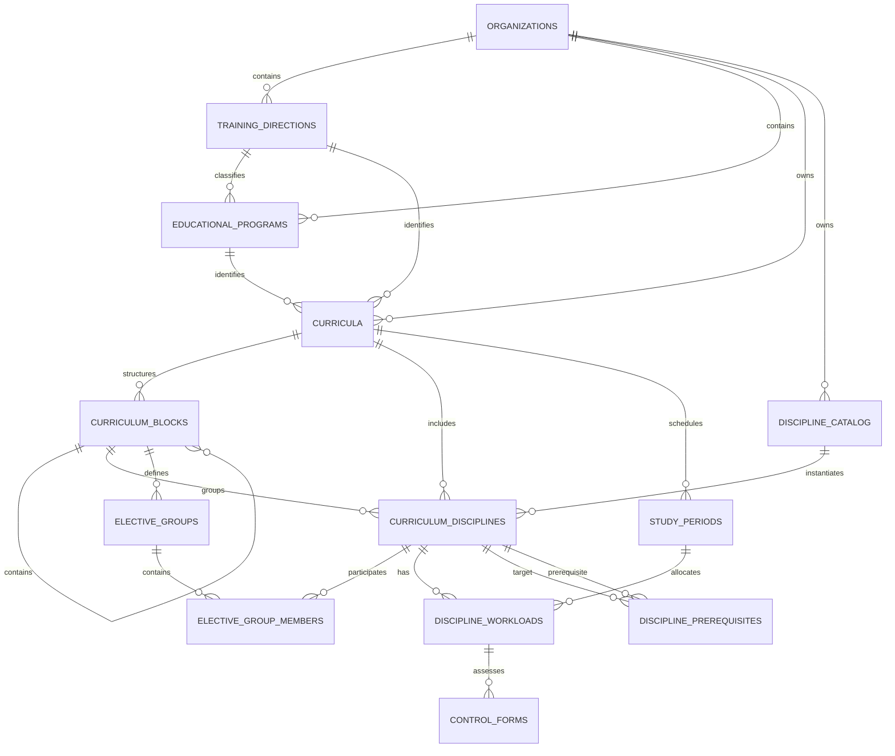

# Модель данных

## Цель и принципы

Модель данных описывает целевую систему и поддерживает редактирование учебного плана, совместную работу, проверку ограничений, версионирование и согласование. Таблицы workflow и импорта вводятся только в соответствующих post-MVP релизах. Текущее состояние плана хранится в нормализованном виде, чтобы PostgreSQL обеспечивал ссылочную целостность и атомарное изменение отдельных сущностей. Сохраненные версии хранятся как неизменяемые JSONB-снимки.

Основные принципы:

- каждый бизнес-модуль владеет своей схемой и не обращается напрямую к таблицам другого модуля;
- межмодульные ссылки хранятся как идентификаторы без внешних ключей между схемами;
- публичные идентификаторы генерируются приложением в формате UUID v4 через `UUID.randomUUID()` Java 21;
- все даты и время хранятся как `TIMESTAMPTZ`;
- удаление значимых бизнес-данных выполняется логически через статус или `archived_at`;
- стабильные закрытые наборы статусов реализуются как Java enum и `TEXT` с `CHECK`, а администрируемые наборы значений - отдельными таблицами-справочниками;
- изменение редактируемых сущностей защищается полем `row_version` для optimistic locking.

Модули используют один экземпляр PostgreSQL и раздельные схемы. В MVP backend может работать под общей DB-ролью, но миграции и права владения таблицами разделены логически. Межмодульные SQL-запросы, JPA-связи и межсхемные внешние ключи запрещены; доступ выполняется через application API модуля-владельца. При выделении модуля ему назначаются отдельные DB credentials и физическая БД.

PostgreSQL ENUM не используется для доменных статусов, которые могут развиваться вместе с процессами согласования и интеграциями. `TEXT CHECK` проще изменять и откатывать через Flyway, а таблицы-справочники позволяют менять администрируемые значения без DDL. PostgreSQL ENUM допустим только для действительно неизменяемого технического набора значений после отдельного архитектурного решения.

## Владение данными

| Схема | Владелец | Основные данные |
|---|---|---|
| `auth` | Identity | пользователи, роли, внешние учетные записи |
| `curriculum` | Curriculum | программы, направления, планы, дисциплины, модули, нагрузка |
| `versioning` | Versioning | JSONB-снимки версий |
| `validation` | Validation | нормативные документы, ограничения, запуски проверок |
| `workflow` | Workflow | маршруты, этапы, решения и замечания |
| `files` | Files | staging импорта, issues и история применения |

## Ядро учебного плана

### Организация и образовательные сущности

`organizations` содержит границу организации для будущего расширения. В MVP в таблице существует одна запись ВШЭ.

`training_directions` представляет направление подготовки и содержит его код и название.

`educational_programs` представляет образовательную программу. Программа может быть связана с направлением, но учебный план хранит обе ссылки явно, поскольку это часть его бизнес-идентичности и импортируемых данных.

`curricula` представляет редактируемый учебный план и обязательно связан с:

- образовательной программой;
- направлением подготовки;
- годом набора.

Группа и уровень образования в модель MVP не входят. Поле `revision` увеличивается при каждой успешной команде изменения плана и используется как версия агрегата.

### Каталог и элементы плана

`discipline_catalog` хранит вузовский справочник дисциплин: стабильный код, официальное название и базовые атрибуты.

`curriculum_disciplines` хранит включение дисциплины из каталога в конкретный план. Здесь находятся плановые атрибуты: локальное название при необходимости, общая трудоемкость, зачетные единицы и позиция в структуре плана.

Такое разделение позволяет переиспользовать одну каталожную дисциплину в нескольких планах, не смешивая общевузовские сведения с параметрами конкретного набора.

### Блоки и дисциплины по выбору

`curriculum_blocks` задает иерархию разделов плана. Поле `block_type` принимает значения `REQUIRED`, `ELECTIVE` или `OPTIONAL`.

`elective_groups` описывает правило выбора внутри блока: минимальное и максимальное число дисциплин либо требуемое количество зачетных единиц.

`elective_group_members` связывает группу выбора с дисциплинами конкретного плана.

### Учебные модули и нагрузка

`study_periods` описывает периоды плана. Для MVP `period_type = MODULE`, а сочетание `study_year` и `period_number` уникально в пределах плана; `period_number` принимает значения от 1 до 4.

Отдельная сущность периода оставляет возможность позднее добавить семестры или иные календари без изменения связей нагрузки.

`discipline_workloads` распределяет нагрузку дисциплины по учебным модулям. Хранятся часы по видам занятий, самостоятельная работа и зачетные единицы периода. Тепловая карта строится агрегацией этой таблицы.

`control_forms` хранит формы контроля дисциплины в конкретном модуле: экзамен, зачет, проект и другие значения из справочника.

Преподаватель пока не входит в расчет. В дальнейшем таблица `teaching_assignments` сможет связать `discipline_workloads` с пользователем или внешней кадровой сущностью и распределить долю часов.

### Пререквизиты

`discipline_prerequisites` связывает две дисциплины одного учебного плана. Обе ссылки указывают на `curriculum_disciplines`; прикладная и DB-валидация запрещают ссылку на себя, связь между разными планами и циклы в графе.

## ER-диаграмма доменного ядра

## Ключевые таблицы

### `curriculum.curricula`

| Поле | Тип | Ограничение |
|---|---|---|
| `id` | UUID | PK, UUID v4 |
| `organization_id` | UUID | FK, NOT NULL |
| `educational_program_id` | UUID | FK, NOT NULL |
| `training_direction_id` | UUID | FK, NOT NULL |
| `admission_year` | SMALLINT | NOT NULL, разумный диапазон года |
| `title` | TEXT | NOT NULL |
| `status` | TEXT | `DRAFT`, `ACTIVE`, `ARCHIVED` |
| `revision` | BIGINT | NOT NULL, начинается с 0 |
| `created_by` | UUID | идентификатор пользователя Identity |
| `created_at`, `updated_at` | TIMESTAMPTZ | NOT NULL |
| `archived_at` | TIMESTAMPTZ | NULL |

Уникальность активного плана задается по организации, программе, направлению и году набора с учетом бизнес-правила о допустимом числе параллельных планов.

### `curriculum.curriculum_disciplines`

| Поле | Тип | Ограничение |
|---|---|---|
| `id` | UUID | PK |
| `curriculum_id` | UUID | FK, NOT NULL |
| `block_id` | UUID | FK, NOT NULL |
| `catalog_discipline_id` | UUID | FK, NOT NULL |
| `display_name` | TEXT | NULL, локальное переопределение |
| `total_hours` | INTEGER | NOT NULL, `>= 0` |
| `total_credits` | NUMERIC(6,2) | NOT NULL, `>= 0` |
| `sort_order` | INTEGER | NOT NULL |
| `row_version` | BIGINT | NOT NULL |
| `created_at`, `updated_at` | TIMESTAMPTZ | NOT NULL |

### `curriculum.study_periods`

| Поле | Тип | Ограничение |
|---|---|---|
| `id` | UUID | PK |
| `curriculum_id` | UUID | FK, NOT NULL |
| `period_type` | TEXT | для MVP `MODULE` |
| `study_year` | SMALLINT | NOT NULL, `>= 1` |
| `period_number` | SMALLINT | NOT NULL, для модулей от 1 до 4 |
| `title` | TEXT | NOT NULL |
| `sort_order` | INTEGER | NOT NULL |

Уникальное ограничение: `(curriculum_id, period_type, study_year, period_number)`.

### `curriculum.discipline_workloads`

| Поле | Тип | Ограничение |
|---|---|---|
| `id` | UUID | PK |
| `curriculum_discipline_id` | UUID | FK, NOT NULL |
| `study_period_id` | UUID | FK, NOT NULL |
| `lecture_hours` | INTEGER | NOT NULL, `>= 0` |
| `seminar_hours` | INTEGER | NOT NULL, `>= 0` |
| `practice_hours` | INTEGER | NOT NULL, `>= 0` |
| `self_study_hours` | INTEGER | NOT NULL, `>= 0` |
| `credits` | NUMERIC(6,2) | NOT NULL, `>= 0` |
| `row_version` | BIGINT | NOT NULL |

Уникальное ограничение: `(curriculum_discipline_id, study_period_id)`.

## Версии и согласование

### `versioning.curriculum_versions`

| Поле | Тип | Назначение |
|---|---|---|
| `id` | UUID | идентификатор версии |
| `curriculum_id` | UUID | логическая ссылка на план |
| `version_number` | INTEGER | последовательный номер в плане |
| `source_revision` | BIGINT | ревизия рабочего плана |
| `schema_version` | INTEGER | версия структуры JSON-снимка |
| `snapshot` | JSONB | полный неизменяемый снимок плана |
| `validation_status` | TEXT | `PENDING`, `RUNNING`, `COMPLETED`, `FAILED`, `UNAVAILABLE` |
| `validation_outcome` | TEXT | NULL до завершения, затем `ACCEPT`, `WARNING` или `ERROR` |
| `validation_run_id` | UUID | логическая ссылка на запуск Validation |
| `validation_summary` | JSONB | NULL до завершения, затем агрегированные результаты проверки |
| `validation_updated_at` | TIMESTAMPTZ | время последнего перехода validation status |
| `content_hash` | TEXT | SHA-256 канонического снимка |
| `comment` | TEXT | комментарий автора |
| `created_by` | UUID | логическая ссылка на пользователя |
| `created_at` | TIMESTAMPTZ | время создания |

Уникальное ограничение: `(curriculum_id, version_number)`. Обновление `snapshot` после вставки запрещается на уровне приложения и ограничений БД. Асинхронно обновляются только поля validation metadata.

`content_hash` вычисляется как SHA-256 от канонического JSON snapshot: ключи объектов упорядочиваются, а числа, массивы и отсутствующие значения сериализуются единообразно. Hash используется для:

- проверки, что immutable snapshot не был поврежден или изменен;
- быстрого определения идентичного содержимого без сравнения всего JSONB;
- ключа кеша и исключения повторной генерации экспорта для того же содержимого;
- диагностической проверки при восстановлении и переносе данных.

Hash не является электронной подписью и не подтверждает автора. Защита от умышленной подмены потребовала бы подписанного hash или неизменяемого хранилища, что не входит в MVP.

### Workflow

`workflow.approval_instances` ссылается на `curriculum_version_id`, а не на изменяемое состояние плана. `approval_steps` хранит последовательность ролей, решения и время. `approval_comments` хранит замечания к версии и при необходимости ссылку на конкретную сущность внутри snapshot в виде стабильного доменного UUID.

Если версия имеет `validation_outcome = WARNING`, `approval_instances` хранит `warning_acknowledged_by`, `warning_acknowledged_at` и комментарий подтверждения. Версии со статусом проверки, отличным от `COMPLETED`, либо с outcome `ERROR` не принимаются в workflow.

При возврате на доработку версия остается неизменной со статусом `CHANGES_REQUESTED`. Методист исправляет рабочий план и создает новую версию для следующего запуска согласования.

## Нормативные ограничения

Для MVP правила представлены таблицами, а не универсальным языком правил:

- `validation.regulatory_documents` - нормативный документ и ссылка на исходный файл;
- `validation.rule_sets` - набор правил с периодом действия;
- `validation.constraint_rules` - тип проверки, целевой объект, оператор, пороговые значения и параметры JSONB;
- `validation.extraction_runs` - результат автоматического извлечения правил из файла;
- `validation.rule_corrections` - исправления администратора с автором и причиной;
- `validation.validation_runs` - запуск проверки конкретной ревизии или версии;
- `validation.validation_results` - нарушения и рекомендации по отдельным правилам.

Типизированные поля `rule_type`, `metric`, `operator`, `min_value` и `max_value` покрывают простые ограничения. `parameters JSONB` используется только для параметров конкретного типа правила, а не как замена всей реляционной модели.

`validation_runs.status` принимает `PENDING`, `RUNNING`, `COMPLETED`, `FAILED` или `UNAVAILABLE`. `validation_results.result` принимает `ACCEPT`, `WARNING` или `ERROR`; `INFO` в MVP не используется. Агрегированный outcome определяется в порядке строгости `ERROR > WARNING > ACCEPT`.

## Файлы

Импорт использует staging-модель:

- `files.imports` хранит `id`, `organization_id`, тип импорта, исходное имя, MIME-тип, размер, SHA-256, автора, статус `READY_FOR_REVIEW`, `APPLIED` или `REJECTED` и временные метки;
- `files.import_staging_documents` хранит нормализованный JSONB payload и версию его схемы;
- `files.import_issues` хранит ошибки и предупреждения сопоставления с указанием исходной строки или поля;
- `files.import_applications` фиксирует явное подтверждение пользователя и результат применения.

Бинарный файл не сохраняется в PostgreSQL. Он существует только во временном каталоге во время синхронной проверки и разбора и удаляется после завершения запроса. Экспортные артефакты и export jobs не хранятся: документ формируется из immutable version и передается клиенту потоковым ответом.

Staging не имеет внешних ключей к таблицам Curriculum. После подтверждения Files передает нормализованную команду в Curriculum через публичный application API; Curriculum применяет весь план одной транзакцией. При ошибке рабочий план не изменяется.

## Совместное редактирование

Постоянный журнал каждой UI-операции для MVP не требуется. Команда изменения содержит:

- серверный `operation_id` для корреляции; клиентский `Idempotency-Key` используется только для retry-sensitive POST-операций;
- идентификатор плана и изменяемой сущности;
- ожидаемый `row_version`;
- структурированные изменяемые поля.

Curriculum выполняет условный `UPDATE`, увеличивает `row_version` и `curricula.revision` в одной транзакции. При несовпадении версии возвращается конфликт `409`, после чего клиент получает актуальную сущность. После commit внутрипроцессное событие передается Collaboration для доставки активным WebSocket-клиентам. Если Collaboration выделяется в сервис, транспорт и гарантия доставки выбираются отдельно. Presence хранится в памяти одного экземпляра либо в Redis после масштабирования.

## Модель ревизий и ETag

Используются два уровня контроля конкурентных изменений:

| Поле | Область | Когда увеличивается | Назначение |
|---|---|---|---|
| `curricula.revision` | весь учебный план | при любой успешной команде, изменяющей план или вложенную сущность | обнаружение изменения агрегата, REST resync, порядок live-событий и `source_revision` версии |
| `row_version` | отдельная изменяемая сущность | только при изменении соответствующей строки | точный optimistic locking без блокировки независимых сущностей |

Изменение дисциплины одной транзакцией увеличивает `curriculum_disciplines.row_version` и `curricula.revision`. `row_version` другой дисциплины не меняется. Для `GET /curricula/{curriculum_id}` ETag строится из aggregate revision; для отдельной сущности - из ее `row_version`. Snapshot-версия сохраняет `source_revision`, но дальнейшие изменения рабочего плана не меняют snapshot.

## Индексы

Минимальный набор индексов:

- индексы на все внешние ключи внутри каждой схемы;
- `curricula (organization_id, educational_program_id, admission_year)` для списка планов;
- `curriculum_disciplines (curriculum_id, block_id, sort_order)` для загрузки редактора;
- `study_periods (curriculum_id, sort_order)`;
- `discipline_workloads (study_period_id, curriculum_discipline_id)` для тепловой карты;
- `curriculum_versions (curriculum_id, version_number DESC)`;
- `approval_instances (curriculum_version_id, status)`;
- `validation_results (validation_run_id, result)`;
- `imports (organization_id, created_at)`;
- `import_issues (import_id, severity)`;
- при принятии transactional outbox: уникальный индекс по `event_id` и индекс по непубликованным событиям.

GIN-индекс на `snapshot` не создается заранее: основной доступ к версии выполняется по `curriculum_id` и номеру. Индекс добавляется только при появлении подтвержденных запросов по содержимому JSONB.

## Целостность и транзакции

- изменения одной команды учебного плана выполняются в одной транзакции Curriculum;
- одна транзакция изменяет таблицы только одного модуля-владельца; cross-module write transaction запрещена без отдельного ADR;
- внутрипроцессное событие публикуется после commit; способ доставки межпроцессного события определяется отдельным принятым решением;
- межпроцессные сценарии являются eventually consistent и используют идемпотентных consumers выбранного транспорта;
- суммы нагрузки и отсутствие циклов проверяются доменной логикой, поскольку обычные `CHECK` и FK не покрывают эти правила;
- восстановление версии не изменяет старый snapshot, а заменяет рабочее состояние плана новой транзакцией и увеличивает ревизию;
- миграции выполняются Flyway отдельно для каждой модульной схемы.

## Очереди фоновых задач

Каждый модуль с долговечной фоновой обработкой хранит job table в собственной схеме. Минимальные поля: `id`, `job_type`, `business_key`, `payload`, `status`, `attempt`, `available_at`, `locked_by`, `locked_until`, `created_at`, `started_at`, `finished_at` и безопасное описание последней ошибки.

Уникальный индекс по `(job_type, business_key)` предотвращает повторное создание одного логического задания. Worker захватывает batch через `FOR UPDATE SKIP LOCKED`; истекший `locked_until` позволяет восстановить задание после падения процесса. Payload содержит только данные, необходимые для повторного чтения актуального состояния, а обработчик остается идемпотентным.

## Отложенные решения

1. Точный набор видов аудиторной нагрузки и форм контроля.
2. Правила уникальности параллельных учебных планов одной программы и года набора.
3. Модель организационных подразделений и область доступа пользователей.
4. Структура `teaching_assignments` после подключения данных о преподавателях.
5. Сроки хранения импортов, экспортов и snapshot-версий.
