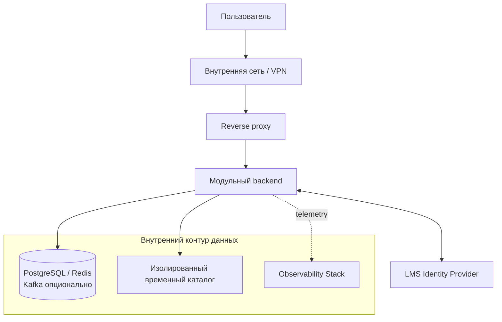

# Обзор безопасности

## Область обзора

Документ оценивает архитектуру web-системы управления учебными планами: модульный backend, REST API, STOMP/WebSocket, PostgreSQL, Redis и интеграцию с LMS ВШЭ. Kafka и MinIO рассматриваются только как возможные будущие компоненты. Контрмеры применяются начиная с релиза, в котором появляется соответствующий компонент. Проверка реализации, конфигурации инфраструктуры и penetration testing проводятся отдельно перед пилотной эксплуатацией.

## Исходные условия

- доступ разрешен только из внутренней сети ВУЗа или через корпоративный VPN;
- пользователи аутентифицируются через внешний identity provider LMS;
- система хранит ФИО, email, роли и организационную принадлежность пользователя;
- иные конфиденциальные и специальные категории персональных данных не входят в MVP;
- импортируемые файлы считаются недоверенными независимо от их источника;
- конкретная платформа виртуализации и оркестрации пока не выбрана;
- backend и web-клиент поставляются как OCI/Docker-образы.

Централизованный бизнес-аудит и гарантированное долговременное хранение истории действий не входят в MVP. Технические логи и история версий помогают диагностике, но не считаются полноценным аудитом.

Внутренняя сеть и VPN уменьшают поверхность атаки, но не заменяют аутентификацию, авторизацию, TLS и журналирование.

## Защищаемые активы

| Актив | Требуемое свойство |
|---|---|
| Текущее состояние учебного плана | целостность, доступность, контроль доступа |
| Сохраненные и согласуемые версии | неизменяемость, целостность, прослеживаемость |
| Решения и комментарии согласования | подлинность автора, неизменяемость |
| Нормативные правила | целостность, контролируемость административных изменений |
| Файлы импорта и экспорта | конфиденциальность в пределах ВУЗа, целостность, безопасная обработка |
| Профили пользователей и роли | конфиденциальность, корректность авторизации |
| Токены, ключи и пароли приложения | конфиденциальность, ограничение области действия |

## Границы доверия

Переход через каждую границу требует отдельного контроля. Наиболее важны границы browser/reverse proxy, reverse proxy/backend, backend/временный volume и backend/внешняя LMS.

## Модель угроз

| Угроза | Риск | Контроли |
|---|---|---|
| Подмена пользователя или повторное использование токена | высокий | проверка подписи, issuer, audience, срока жизни; короткоживущий access token; отзыв сессии на стороне IdP |
| BOLA: доступ к чужому учебному плану по UUID | высокий | проверка роли и организационной области на каждом объектном endpoint; негативные authorization-тесты |
| Назначение себе роли через изменяемые claims или API | высокий | роли хранятся во внутренней модели; административные операции отделены и требуют повышенных прав |
| Загрузка вредоносного XLSX, XML или архива | высокий | allowlist форматов, проверка MIME/signature/размера, антивирус, изолированный временный каталог, запрет внешних XML-сущностей, лимиты распаковки |
| Подписка STOMP на чужой curriculum topic | высокий | авторизация CONNECT и каждой SUBSCRIBE/SEND destination; запрет произвольных destination |
| Инъекция в SQL, фильтры или шаблоны экспорта | высокий | Bean Validation, параметризованные запросы/JPA, allowlist полей сортировки, escaping шаблонов |
| Изменение согласуемой версии | высокий | immutable snapshot, hash содержимого, отдельные DB-права без UPDATE snapshot |
| Переполнение временного каталога | высокий | лимит запроса и volume, ограничение параллелизма, очистка в `finally` и при старте |
| CSRF или XSS в web-клиенте | средний | токен в HttpOnly Secure SameSite cookie предпочтительно; CSRF token для cookie-сессии; CSP без `unsafe-inline`; escaping пользовательского текста |
| Компрометация backend | высокий | минимальные права DB и volume, Kafka ACL при использовании, сетевые политики, непривилегированный контейнер, резервное копирование и быстрое восстановление |
| Утечка токенов или персональных данных через логи и traces | средний | централизованная redaction, запрет body/Authorization/cookie в telemetry, ограничение доступа и retention |
| Уязвимая зависимость или контейнерный образ | средний | lock-файлы, SCA, SBOM, image scanning, подпись образов, регулярное обновление base image |

## Аутентификация

Предпочтительный протокол интеграции с LMS - OpenID Connect Authorization Code Flow с PKCE. Если LMS поддерживает только SAML или собственный механизм, он инкапсулируется в Identity; прикладные модули не зависят от протокола LMS.

Identity обращается к LMS/Identity Provider напрямую. Integration предназначен для предметного обмена с другими ИС ВУЗа и не включается в критический путь входа.

Обязательные проверки токена:

- подпись только разрешенным алгоритмом;
- точное совпадение `issuer` и `audience`;
- проверка `exp`, `nbf` и допустимого clock skew;
- стабильный внешний `subject`, связанный с внутренним `user_id`;
- запрет принятия прикладных ролей из непроверяемых клиентских claims.

Для web-клиента предпочтительна BFF/cookie-сессия с `HttpOnly`, `Secure`, `SameSite=Lax` или `Strict`. Если браузер получает bearer token напрямую, он хранится только в памяти и не помещается в `localStorage`.

## Авторизация

Используется сочетание RBAC и объектной области доступа:

| Действие | Методист | Заведующий | Директор | Администратор |
|---|---:|---:|---:|---:|
| Читать доступный план | да | да | да | да |
| Изменять рабочий план | да | нет | нет | по отдельному административному разрешению |
| Сохранять версию | да | нет | нет | нет |
| Решение на своем этапе | нет | да | да | нет |
| Управлять правилами и справочниками | нет | нет | нет | да |
| Управлять пользователями и ролями | нет | нет | нет | да |

Роль не дает глобальный доступ автоматически. Каждый запрос проверяет принадлежность плана образовательной программе и область полномочий пользователя. Проверка выполняется прикладным модулем, а не только входным security filter.

Spring Security выполняет coarse-grained проверку endpoint и формирует доверенный контекст запроса. Прикладной модуль выполняет окончательную object-level проверку по сочетанию:

- `user_id` и активного состояния пользователя;
- роли и разрешенного действия;
- `organization_id`;
- списка или policy scope образовательных программ;
- атрибутов ресурса и текущего этапа workflow.

Клиент не может задавать роли и scopes через HTTP headers. Внутри процесса authorization context не сериализуется и доступен только на время обработки запроса или WebSocket-сессии. Подписанный контекст с `issuer`/`audience` потребуется при выделении отдельного сервиса.

## REST и STOMP

### REST

- OpenAPI используется как allowlist входных полей и ограничений;
- `If-Match` защищает от потери конкурентных изменений;
- body, path и query валидируются до вызова доменной логики;
- неизвестные поля изменяющих DTO отклоняются;
- rate limit применяется по пользователю и нормализованному endpoint;
- stack trace, SQL и внутренние адреса не возвращаются клиенту;
- CORS разрешает только утвержденные origin внутреннего web-клиента.

### STOMP/WebSocket

- токен проверяется при CONNECT, а срок сессии не превышает срок токена;
- Origin проверяется на handshake;
- SUBSCRIBE разрешается только после проверки доступа к `curriculum_id`;
- SEND разрешен только для presence destination;
- ограничиваются размер кадра, частота heartbeat и число подписок;
- после reconnect клиент сверяет revision через REST.

## Безопасность файлов

Поток загрузки:

1. Приложение проверяет право пользователя до чтения multipart body.
2. Backend ограничивает размер и записывает файл под случайным именем в изолированный временный каталог.
3. Files проверяет расширение, MIME, magic bytes и SHA-256.
4. Антивирус выполняет сканирование до парсинга.
5. XML-парсер работает с отключенными DTD и external entities; архивы имеют лимиты размера и числа элементов.
6. После разбора сохраняются только staging JSON, issues и метаданные; временный файл удаляется в `finally`.

Временный каталог недоступен через HTTP, имеет quota и очищается при старте после аварийного завершения. Исходные имена очищаются перед использованием в `Content-Disposition`; экспорт передается потоково без промежуточной публикации URL.

## Секреты и шифрование

- секреты не входят в образ, Git, OpenAPI, логи или переменные frontend-сборки;
- секреты передаются контейнеру через механизм secrets выбранной платформы, предпочтительно как mounted file;
- доступ backend ограничен минимальными DB credentials и правами на временный каталог; Kafka principal и MinIO policy добавляются только при принятии соответствующих компонентов;
- TLS обязателен от клиента до reverse proxy и для интеграции с LMS;
- внутренний TLS требуется для внешних зависимостей и выделенных сервисов;
- PostgreSQL, временный volume и резервные копии используют шифрование дисков инфраструктуры ВУЗа;
- ротация credentials не требует пересборки образа.

## Контейнеры и цепочка поставки

- multi-stage build и минимальный JRE 21 runtime image;
- запуск от непривилегированного UID, запрет root и privileged mode;
- read-only root filesystem, отдельный временный volume с лимитом;
- отсутствие shell и package manager в runtime image, если они не нужны;
- фиксированные версии base image и зависимостей;
- SBOM в CycloneDX или SPDX для каждого релиза;
- SCA и image scan в CI, блокировка релиза при critical/high уязвимостях без принятого исключения;
- подпись образов и проверка подписи при развертывании после выбора платформы.

## Проверки перед пилотом

Перед каждым релизом выполняются только применимые проверки; STOMP и import-security наборы становятся блокирующими начиная с Post-MVP 1.

1. Интеграционные тесты `401`, `403`, BOLA и разграничения ролей для каждого типа ресурса.
2. Тестирование STOMP CONNECT/SUBSCRIBE с чужим curriculum ID и истекшим токеном.
3. Набор вредоносных файлов: XXE, zip bomb, formula injection, неверный MIME и oversized upload.
4. Проверка CSP, CORS, cookie flags и CSRF-защиты.
5. SAST, SCA, secret scanning, SBOM и container scan в CI.
6. Проверка восстановления PostgreSQL из резервной копии и очистки временного каталога после перезапуска.
7. DAST и ручной security review перед доступом реальных пользователей.

## Открытые риски

1. Протокол и claims LMS пока неизвестны; финальная схема токенов требует обследования.
2. Платформа виртуализации не выбрана; mTLS, network policies, secrets и image admission уточняются после выбора.
3. Антивирусный движок и способ изоляции парсеров файлов не выбраны.
4. Организационная модель доступа по кампусам, факультетам и кафедрам не утверждена.
5. Нет формальных RTO/RPO; до пилота необходимо определить минимально допустимую стратегию резервного копирования и восстановления.
