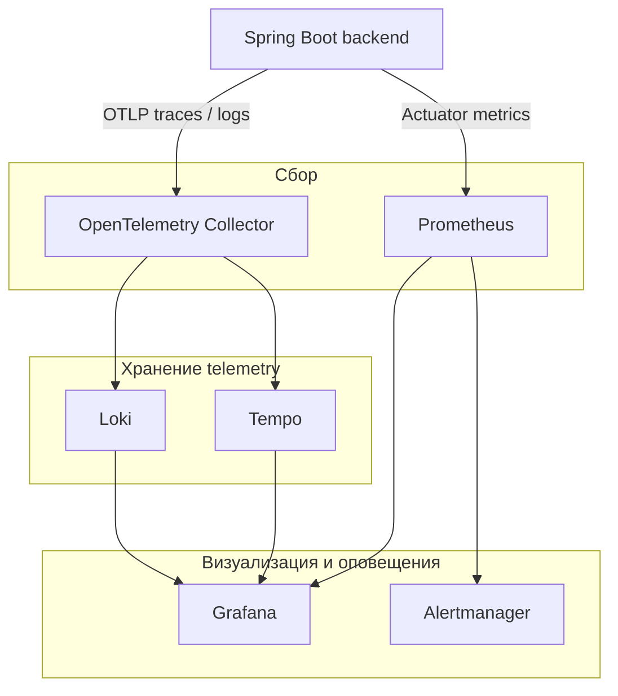

# Наблюдаемость и эксплуатация

## Цели

Документ описывает целевой набор telemetry. Метрики и dashboards подключаются по мере появления соответствующих модулей, инфраструктуры и процессов в MVP и post-MVP релизах.

Наблюдаемость должна позволять ответить на четыре вопроса:

1. Доступна ли система пользователям внутренней сети и VPN?
2. Где и почему завершился ошибкой пользовательский запрос, фоновая задача или Kafka-процесс?
3. Достаточно ли ресурсов backend, PostgreSQL, Redis, временного volume и опционального брокера?
4. Как выполняются ключевые бизнес-процессы: редактирование, валидация, согласование, импорт и экспорт?

Формальные SLA, SLO, RTO и RPO для MVP не задаются. Система собирает необходимые SLI с первой версии, чтобы цели можно было установить на основании пилотных данных.

## Стек

| Назначение | Компонент |
|---|---|
| Инструментация Java | Spring Boot Actuator, Micrometer, OpenTelemetry Java agent/SDK |
| Сбор telemetry | OpenTelemetry Collector |
| Метрики | Prometheus |
| Дашборды и визуализация | Grafana |
| Логи | Loki |
| Трассировка | Tempo |
| Оповещения | Alertmanager |

Backend отправляет traces и при необходимости logs по OTLP в OpenTelemetry Collector. Prometheus получает метрики с защищенного Actuator endpoint. Backend-компоненты могут быть заменены существующим стеком мониторинга ВУЗа без изменения инструментации приложения.

## Поток telemetry

## Контекст и корреляция

Backend API принимает корректный внешний `X-Request-ID` или создает новый UUID. W3C `traceparent` является основным механизмом распространения trace context.

Контекст передается через:

- HTTP: `traceparent`, `tracestate`, `X-Request-ID`;
- при принятии Kafka - headers с trace context, `correlation_id`, `event_id`;
- STOMP native headers: `traceparent`, `correlation_id`, `event_id`;
- job records: исходные `request_id` и `trace_id`.

Модуль сохраняет `request_id` при внутрипроцессном вызове. Для фоновой обработки создается новый span, связанный с исходным context; Kafka consumer извлекает context из headers.

## Структурированные логи

Production-логи пишутся в JSON в stdout контейнера. Обязательные поля:

- `timestamp` в ISO 8601 UTC;
- `level`, `application`, `module`, `application_version`, `environment`;
- `trace_id`, `span_id`, `request_id`;
- `event`, `message`;
- нормализованный `http.route`, метод и статус при HTTP-запросе;
- `error.type` и безопасное `error.message` при ошибке.

В логах запрещены:

- Authorization, cookies, refresh/access token и содержимое импортируемых файлов;
- request/response body по умолчанию;
- содержимое учебного плана, нормативного документа или файла;
- email и ФИО без подтвержденной диагностической необходимости;
- stack trace в ответе клиенту.

INFO используется по умолчанию. DEBUG включается временно для backend или конкретного logger и автоматически возвращается к INFO. Технические логи используются для диагностики и не являются гарантированной историей пользовательских действий; полноценный бизнес-аудит не входит в MVP.

## Метрики приложения

Backend предоставляет RED-метрики с дополнительным низкокардинальным label `module` для ключевых операций:

- rate запросов и команд;
- доля `4xx` и `5xx`;
- histogram длительности с p50, p95 и p99;
- число активных запросов;
- состояние connection pool и внешних зависимостей.

Labels ограничиваются значениями с низкой кардинальностью: `application`, `module`, `method`, нормализованный `route`, `status`, `result`, `event_type`. UUID пользователя, плана, версии, файла, `request_id` и raw URI в labels запрещены.

### Доменные метрики

| Метрика | Тип | Назначение |
|---|---|---|
| `curriculum_versions_created_total` | counter | число созданных версий |
| `curriculum_revision_conflicts_total` | counter | конфликты optimistic locking |
| `curriculum_validation_runs_total{result}` | counter | успешные и неуспешные проверки |
| `curriculum_validation_duration_seconds` | histogram | длительность полной проверки |
| `approval_instances_total{status}` | counter | прохождение согласований |
| `file_operations_total{type,result}` | counter | исходы синхронных импортов и экспортов |
| `file_operation_duration_seconds{type}` | histogram | длительность импорта и генерации экспорта |
| `collaboration_sessions_active` | gauge | активные WebSocket/STOMP-сессии |

### Метрики инфраструктуры

- JVM heap, GC pauses, threads и process CPU;
- HikariCP active, idle, pending и timeout;
- PostgreSQL connections, locks, transaction duration, replication/backup state;
- при принятии Kafka - consumer lag, failed deliveries, retries и dead-letter records;
- Redis memory, evictions и expired presence keys;
- заполнение временного volume, число отклоненных multipart uploads и ошибки очистки;
- размер очередей import/export и возраст старейшего job.
- размер validation job queue, возраст старейшего доступного задания, число retry и задания с истекшим lease.

## Distributed tracing

Автоинструментация покрывает Spring MVC, HTTP clients, JDBC, Kafka и Redis. Manual spans добавляются только для доменных операций:

- `curriculum.update`;
- `curriculum.snapshot.create`;
- `curriculum.versions.compare`;
- `curriculum.validate`;
- `approval.decision.record`;
- `file.import.parse`;
- `file.export.generate`.

Span attributes используют тип операции, результат, формат файла и номер ревизии. UUID сущностей, ФИО, email и содержимое данных в attributes не помещаются.

Для MVP применяется parent-based head sampling: 100% в dev/test и начальные 10% успешных production traces. Ошибки и медленные traces должны сохраняться полностью через tail sampling в Collector, если инфраструктура ВУЗа его поддерживает.

## Health endpoints

Spring Boot Actuator публикует отдельные проверки:

- `/actuator/health/liveness` - процесс способен продолжать работу; внешние зависимости не проверяются;
- `/actuator/health/readiness` - backend готов принимать трафик и имеет доступ к обязательным зависимостям;
- `/actuator/prometheus` - метрики, доступные только Prometheus;
- `/actuator/info` - версия образа, commit и время сборки без секретов.

Actuator endpoints недоступны пользовательской сети через Backend API. Readiness не должна перезапускать контейнер при кратковременной недоступности внешней LMS.

## Дашборды

### Обзор системы

- traffic, error rate, p95/p99 и saturation backend с разрезом по модулю;
- доступность backend из внутренней сети;
- состояние PostgreSQL, Redis, временного volume и подключенных опциональных компонентов;
- очереди import/export и, при принятии Kafka, consumer lag;
- число активных STOMP-сессий.

### Учебные планы

- число открытий и изменений планов;
- конфликты редактирования;
- длительность сохранения и сравнения версий;
- длительность и результаты валидации;
- число согласований по статусам;
- распределение времени прохождения этапов согласования.

## Оповещения без формального SLO

Пока SLO не утверждены, используются базовые symptom-based alerts:

| Сигнал | Начальное условие | Важность |
|---|---|---|
| Высокая доля ошибок API | `5xx > 5%` в течение 5 минут | critical |
| Недоступен backend из внутренней сети | 3 последовательные проверки | critical |
| PostgreSQL pool saturation | pending connections или timeout 5 минут | critical |
| Kafka consumer lag, если брокер принят | возраст сообщения превышает 5 минут | warning |
| Import/export failures | более 3 ошибок за 15 минут | warning |
| Высокая p99 latency | более 2 секунд 10 минут для типовых API | warning |
| Временный volume | заполнение более 80% или ошибка очистки | warning |

Пороговые значения являются начальными и корректируются после пилота. Каждый alert содержит `service`, `severity`, описание и ссылку на runbook. Одиночное исключение не создает alert.

## Retention telemetry

Начальные значения, не являющиеся SLA:

- технические логи: 30 дней;
- traces: 7 дней;
- Prometheus metrics: 90 дней либо срок существующей платформы мониторинга ВУЗа;
- dashboards и alert history: по политике общей Grafana/Alertmanager инфраструктуры.

Retention пересматривается после оценки объема данных и требований ВУЗа.

## Контейнерная эксплуатация

Backend собирается в неизменяемые OCI/Docker-образы и не хранит постоянное состояние внутри контейнера. Конфигурация поступает извне; секреты не включаются в image layers.

Обязательные свойства образа:

- непривилегированный пользователь;
- read-only root filesystem;
- корректное завершение по SIGTERM и прекращение приема трафика до shutdown;
- liveness/readiness probes без зависимости от конкретного оркестратора;
- resource requests/limits задаются deployment-платформой после нагрузочных тестов;
- версия image, Git commit и SBOM связаны с релизом.

Для локального и интеграционного окружения допускается Docker Compose. Выбор Kubernetes, Nomad или VM-based container runtime откладывается до определения инфраструктуры ВУЗа.

## Резервное копирование и восстановление

При отсутствии формальных RTO/RPO необходим минимальный эксплуатационный baseline:

- автоматические резервные копии PostgreSQL;
- хранение копий отдельно от рабочих дисков;
- документированная процедура восстановления;
- регулярная тестовая проверка восстановления;
- мониторинг возраста последней успешной копии и результата backup job.

Конкретная частота и срок хранения резервных копий утверждаются до пилота и после этого оформляются как RPO/RTO или операционная политика.

## Runbooks

До пилота создаются runbooks минимум для:

1. высокой доли `5xx` на backend API;
2. исчерпания PostgreSQL connection pool;
3. роста очереди фоновых задач или Kafka lag при использовании брокера;
4. недоступности LMS;
5. переполнения или ошибки очистки временного volume;
6. timeout синхронного импорта или экспорта;
7. восстановления PostgreSQL из резервной копии.

## Критерии готовности

- backend выдает структурированные логи с trace/request context;
- RED-метрики и JVM/HikariCP метрики доступны в Prometheus;
- end-to-end trace проходит через reverse proxy, REST и фоновые обработчики; при использовании Kafka trace context сохраняется в headers;
- dashboards показывают golden signals и ключевые бизнес-потоки;
- критические alerts проверены тестовым срабатыванием;
- telemetry не содержит токенов, содержимого файлов и персональных данных;
- контейнеры корректно проходят liveness/readiness и graceful shutdown.
