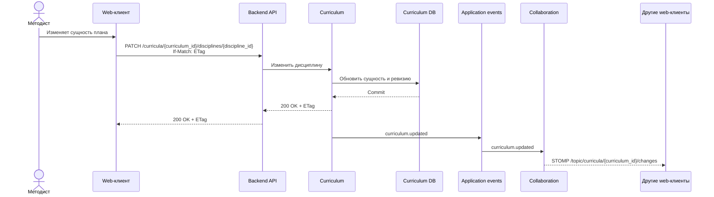
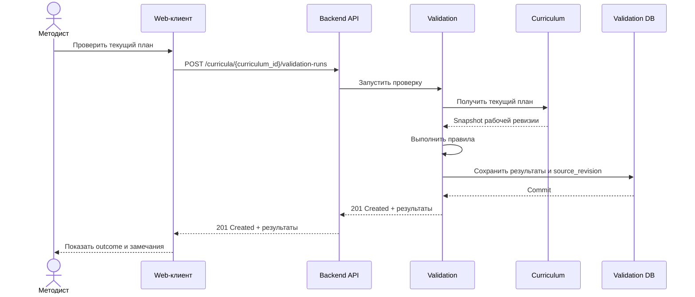
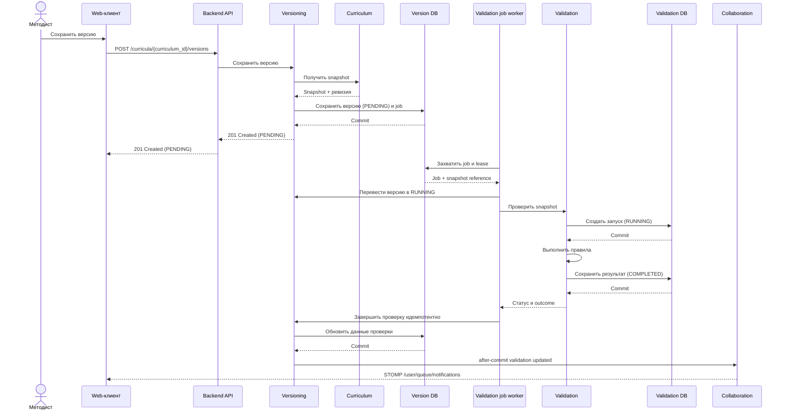
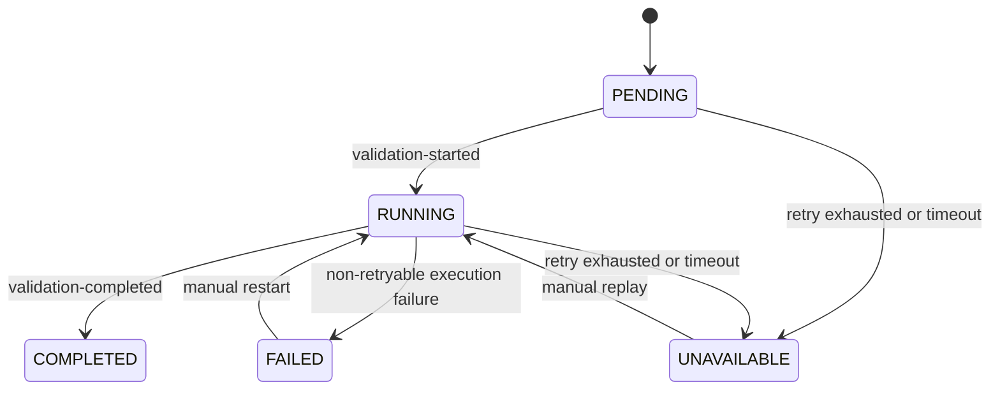
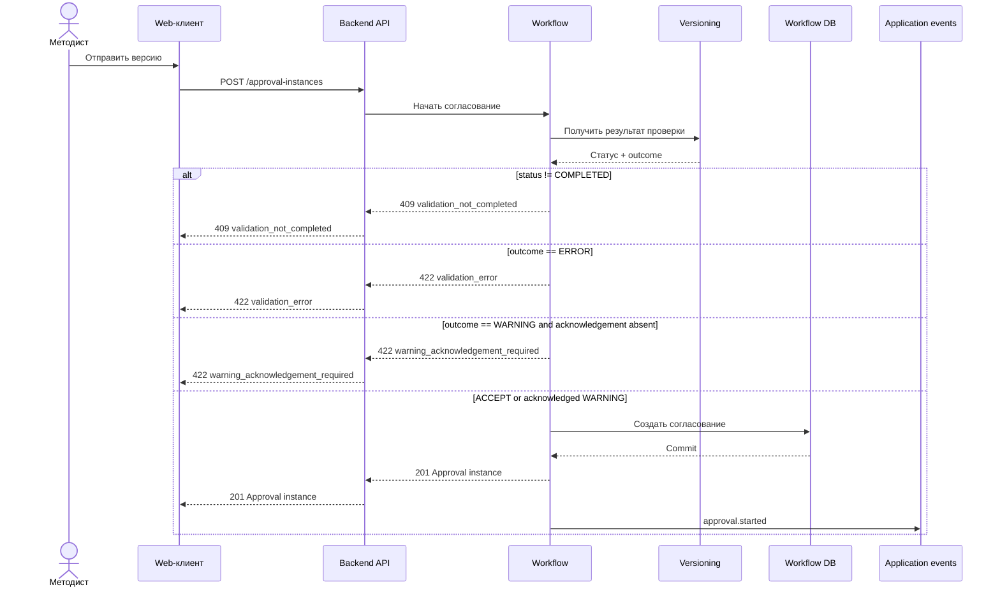
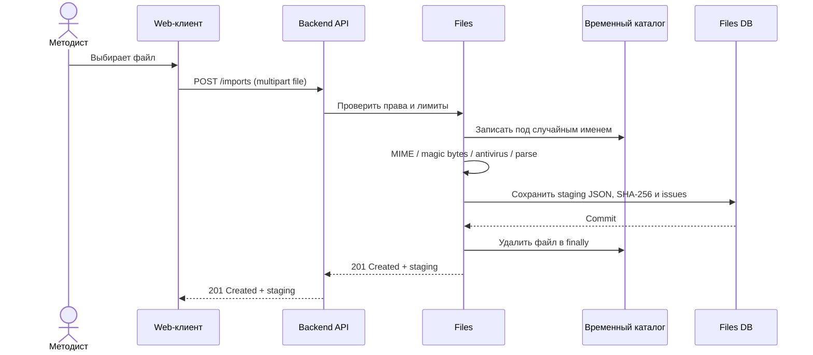
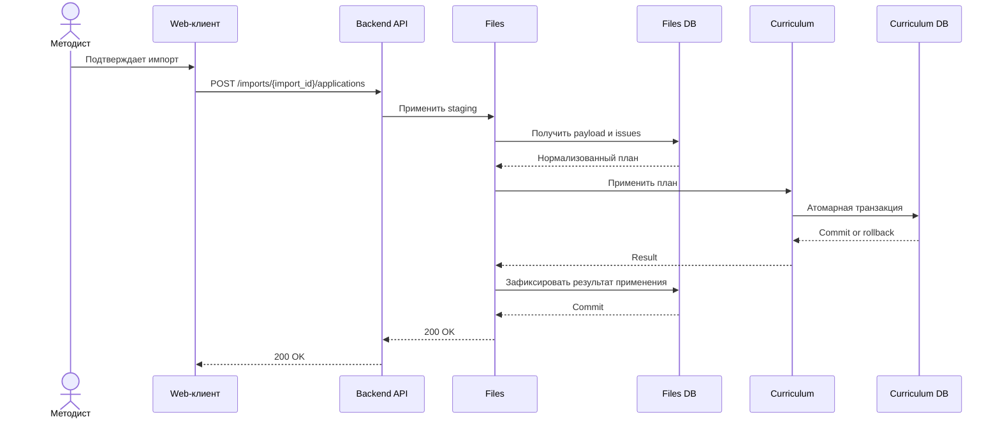

# Динамическая и событийная архитектура

## Цель документа

Документ описывает взаимодействия модулей и внешних компонентов во времени, поведение при частичной недоступности и возможный контракт межпроцессных событий. Сценарии совместного редактирования, асинхронной проверки версии и импорта относятся к Post-MVP 1, согласование - к Post-MVP 2. Внутри модульного монолита асинхронная реакция запускается application event после commit. Kafka и outbox ниже описаны как кандидатное решение, а не обязательная часть релизов.

## Совместное редактирование

### Нормальный режим



STOMP доставляет только подтвержденное изменение. Клиент, инициировавший команду, использует REST response как источник результата и не ждет собственного STOMP event.

На диаграмме показано изменение дисциплины. Для остальных сущностей клиент вызывает соответствующую REST-ручку редактора: `PATCH /curricula/{curriculum_id}` для метаданных плана, `PATCH /curricula/{curriculum_id}/blocks/{block_id}` для блока, `PUT /curricula/{curriculum_id}/disciplines/{discipline_id}/workloads/{period_id}` для нагрузки модуля. Создание и удаление выполняются через соответствующие `POST` и `DELETE`, описанные в OpenAPI. Все изменяющие запросы передаются через Backend API; `PATCH` и `DELETE`, а также зависимые от текущей ревизии `POST` и `PUT` редактора используют `If-Match` согласно контракту конкретной ручки.

### Разрыв WebSocket

При STOMP disconnect клиент отключает presence и выполняет reconnect с backoff. После восстановления соединения клиент сначала получает актуальное состояние и ETag через REST, а затем применяет новые STOMP events. Отдельное состояние degraded mode с периодическим polling не реализуется, пока Collaboration работает внутри одного backend-процесса.

## Промежуточная валидация рабочей ревизии



Промежуточная валидация не создает сохраненную версию и не блокирует редактирование. Результат привязан к `source_revision`: если после проверки ревизия плана изменилась, клиент помечает результат как устаревший и предлагает запустить проверку повторно. Такой результат помогает методисту исправлять план, но не используется для запуска согласования. Для согласования требуется проверка неизменяемой сохраненной версии.

## Сохранение версии и асинхронная валидация



Создание версии не зависит от синхронного выполнения Validation. Версия и job создаются атомарно в схеме Versioning. Snapshot после INSERT не изменяется; обновляются только validation metadata. После падения worker задание с истекшим lease снова становится доступным.

### Статус проверки версии



`UNAVAILABLE` означает, что проверка не была завершена из-за недоступности подсистемы или исчерпания retry. `FAILED` означает техническую ошибку обработки конкретного запуска. Оба статуса блокируют согласование, но не удаляют версию.

### Результат проверки

| Result | Значение | Влияние на согласование |
|---|---|---|
| `ACCEPT` | правило выполнено | разрешено |
| `WARNING` | найдено допустимое отклонение | разрешено после явного подтверждения методиста |
| `ERROR` | нарушено обязательное ограничение | запрещено |

Aggregate outcome равен наиболее строгому результату: `ERROR > WARNING > ACCEPT`. `INFO` в MVP не используется, чтобы не смешивать успешный результат и информационное сообщение.

Versioning помечает `PENDING` или `RUNNING` как `UNAVAILABLE`, если обновление не поступило в установленный операционный срок. Начальное значение для Post-MVP 1 - 5 минут; оно является техническим timeout, а не SLA. После replay status может перейти из `UNAVAILABLE` в `RUNNING`.

## Запуск согласования



Подтверждение warning хранится в approval instance, а не меняет immutable snapshot версии.

## Импорт через staging

### Загрузка и разбор файла



### Применение импорта



Staging payload не является рабочим учебным планом. `ERROR` в import issues блокирует применение; `WARNING` разрешает применение после подтверждения. Curriculum либо применяет весь нормализованный payload, либо откатывает транзакцию целиком.

## Кандидатные Kafka topics для межпроцессной доставки

Раздел описывает возможный контракт на случай принятия ADR-0008. Эти topics не требуются для взаимодействия модулей и не входят в обязательный объем post-MVP. Перед реализацией состав событий и параметры доставки уточняются для конкретных producer и consumers.

Начиная с Post-MVP 1 используются topics по доменным областям, а не отдельный topic на каждый event type.

| Topic | Основные события | Partition key |
|---|---|---|
| `curriculum.events.v1` | `curriculum.updated` | `curriculum_id` |
| `versioning.events.v1` | `curriculum.version-created` | `curriculum_id` |
| `validation.events.v1` | `curriculum.validation-started`, `completed`, `failed` | `curriculum_id` |
| `workflow.events.v1` | `approval.started`, `step-approved`, `returned` | `curriculum_id` |
| `file-jobs.events.v1` | `import.*`, `export.*` | `job_id` |
| `notification.commands.v1` | `notification.requested` | `user_id` |

Все события одного учебного плана, для которых важен порядок, key-ются по `curriculum_id` и попадают в одну partition. Глобальный порядок между разными планами не требуется.

## Event envelope

```json
{
  "event_id": "0e7cf188-4f42-4be8-b3d6-40f46cc45849",
  "event_type": "curriculum.version-created",
  "event_version": 1,
  "occurred_at": "2026-06-30T12:15:00Z",
  "producer": "curriculum-backend.versioning",
  "correlation_id": "req_01J...",
  "causation_id": "cmd_01J...",
  "organization_id": "49970d6d-e0c0-4de3-93e6-44daf19021d5",
  "partition_key": "d9c70dab-cafa-4b5a-a885-edc13117bc2d",
  "payload": {}
}
```

Envelope обязателен для всех topics. Payload описывается JSON Schema рядом с модулем-владельцем. Изменение является совместимым, если добавляет только необязательные поля. Удаление, переименование или изменение смысла поля требует нового `event_version`; producer поддерживает переходный период, пока consumers не обновлены.

## Кандидатная доставка и идемпотентность

### Producer межпроцессного события

1. Бизнес-изменение и outbox row записываются одной локальной транзакцией PostgreSQL.
2. Пользовательская REST-команда подтверждается после commit и не ожидает публикацию Kafka.
3. Outbox publisher выбирает записи небольшими batch через `FOR UPDATE SKIP LOCKED`; максимальный интервал штатного polling - 100 мс.
4. Publisher отправляет событие в Kafka с `event_id` и ожидает broker acknowledgement.
5. После подтверждения outbox row помечается опубликованной.
6. Повторная публикация допустима и не считается ошибкой.

`afterCommit` callback может разбудить локальный publisher и уменьшить среднюю задержку, но не публикует событие напрямую. Если процесс завершится сразу после commit, периодический polling другого экземпляра все равно обнаружит outbox row.

Прямая отправка Kafka только из `afterCommit` не заменяет transactional outbox: между commit БД и broker acknowledgement остается окно падения, в котором изменение сохранено, а событие потеряно.

### Consumer

1. Consumer начинает локальную транзакцию.
2. Пытается вставить `event_id` в собственную inbox table с уникальным PK.
3. Если ID уже существует, событие подтверждается без повторного side effect.
4. Иначе consumer выполняет изменение и сохраняет inbox row в одной транзакции.
5. Kafka offset подтверждается после commit.

Система не полагается на exactly-once Kafka transactions между БД и broker. Гарантия формируется комбинацией transactional outbox, at-least-once delivery и inbox deduplication.

## Retry и DLT

Retryable errors:

- timeout или временная сетевая ошибка;
- временная недоступность PostgreSQL или внешнего сервиса;
- lock timeout и ограниченная resource saturation.

Non-retryable errors:

- событие не соответствует schema;
- неизвестный обязательный `event_version`;
- отсутствует обязательный идентификатор;
- нарушен доменный инвариант, который не изменится при повторе.

Для retryable error используются три отложенные попытки: через 1, 10 и 60 секунд. После исчерпания попыток событие направляется в DLT. Non-retryable error направляется в DLT сразу.

DLT создается на consumer group, а не только на source topic:

```text
<source-topic>.<consumer-group>.dlt
```

Пример: `versioning.events.v1.validation-service.dlt`.

DLT record сохраняет исходные key, payload, headers, exception class, сообщение ошибки, число попыток и время последней обработки. Replay выполняется вручную после исправления причины и не меняет исходный `event_id`.

## Наблюдаемость событий

Обязательные метрики:

- consumer lag и возраст старейшего сообщения;
- `outbox_created_at` → Kafka acknowledgement;
- commit → STOMP delivery для live-изменений;
- количество retry по topic и consumer group;
- число DLT records;
- длительность обработки;
- ошибки inbox/outbox;
- число validation versions в `PENDING`, `RUNNING` и `UNAVAILABLE`;
- возраст старейшей версии в незавершенном validation status.

Логи consumer содержат `event_id`, `event_type`, `event_version`, topic, partition, offset, `correlation_id`, result и retry count. Payload целиком не логируется.

## Политика отказов

| Недоступный компонент | Поведение пользователя |
|---|---|
| WebSocket-канал | клиент выполняет reconnect и REST resync; периодический polling не включается |
| Validation | версия сохраняется с `PENDING`, согласование заблокировано |
| Kafka, если принята | локальные команды сохраняются с outbox; доставка возобновляется после восстановления broker |
| Notification | бизнес-операция завершается, уведомление доставляется после retry |
| Временный volume заполнен | новые импорты отклоняются; редактор и экспорт продолжают работать |
| LMS/IdP | новые входы недоступны; политика уже созданных сессий зависит от срока токена |

## Связанные ADR

1. [ADR-0011](../adr/0011-transactional-outbox-inbox-delivery.md) - предложенная at-least-once Kafka delivery через outbox/inbox, retry и per-consumer DLT.
2. [ADR-0012](../adr/0012-asynchronous-saved-version-validation.md) - асинхронная валидация сохраненной версии с блокировкой согласования до результата.
3. [ADR-0013](../adr/0013-rest-degraded-mode-for-collaboration.md) - proposed degraded mode для будущего выделенного Collaboration Service.
