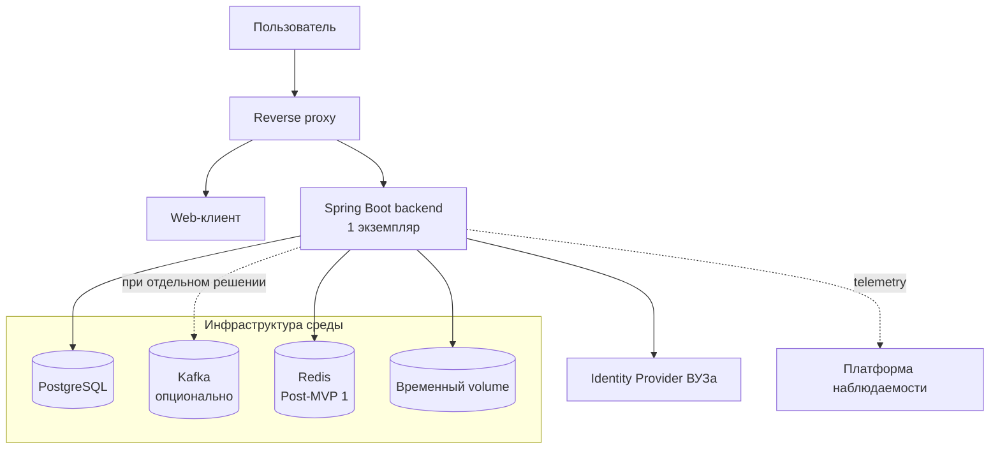

# Развертывание и поставка

## Цель документа

Документ определяет базовые требования к средам, контейнерным образам, конфигурации и масштабированию. Конкретные CI/CD-система, платформа оркестрации и способ предоставления инфраструктурных сервисов пока не выбраны.

Диаграмма показывает базовую топологию. Kafka не входит в обязательную инфраструктуру релизов и добавляется только после отдельного принятого решения. Redis добавляется перед масштабированием real-time функций либо при появлении другого подтвержденного сценария.

## Среды

Для MVP используются две изолированные среды:

| Среда | Назначение | Данные |
|---|---|---|
| `dev` | разработка, интеграционное тестирование и проверка миграций | синтетические или обезличенные |
| `production` | эксплуатация системы | рабочие данные ВУЗа |

Среды не используют общие базы данных, Kafka topics, Redis namespaces, временные volumes, учетные данные или ключи шифрования. Доступ к `production` ограничивается внутренней сетью или VPN и отдельными эксплуатационными полномочиями.

Отдельная staging-среда в MVP не предусматривается. Перед выпуском изменения проверяются в `dev`, после чего тот же неизменяемый образ продвигается в `production` по digest.

## Базовая топология

В начальной конфигурации backend запускается в одном экземпляре. Такая конфигурация не обеспечивает высокую доступность: отказ экземпляра вызывает временную недоступность приложения до перезапуска.

## Контейнерные образы

Backend и web-клиент поставляются как отдельные версионированные OCI-образы. Образы:

- собираются воспроизводимо из зафиксированных версий зависимостей;
- используют multi-stage build и минимальный Java 21 runtime для backend;
- запускаются от непривилегированного пользователя;
- не содержат секретов и environment-specific конфигурации;
- не хранят постоянные данные в локальной файловой системе;
- публикуют liveness, readiness и startup health endpoints;
- идентифицируются версией и неизменяемым digest, тег `latest` не используется.

Один и тот же образ продвигается между средами. Пересборка образа специально для `production` не допускается.

## Готовность к масштабированию

Начальный запуск одного экземпляра не должен становиться ограничением архитектуры:

1. Backend остается stateless относительно пользовательских сессий; постоянное состояние не хранится в памяти экземпляра.
2. При одном экземпляре краткоживущее presence-состояние может храниться в памяти. Перед горизонтальным масштабированием backend оно переносится в Redis и выбирается общий STOMP broker relay либо документируется маршрутизация соединений между экземплярами.
3. При принятии внешнего брокера consumers используют группы выбранного транспорта, а обработчики остаются идемпотентными.
4. Фоновые задания захватываются атомарно и могут выполняться несколькими workers без двойного применения.
5. Планировщики используют distributed lock или leader election, если одновременно может работать более одного экземпляра.
6. Загружаемые файлы существуют только на ограниченном временном volume во время обработки; snapshots хранятся в PostgreSQL, экспорт передается потоково.
7. Миграции БД выполняются отдельным шагом поставки, а не конкурентно каждым экземпляром приложения.

Горизонтальное масштабирование backend включается после появления измеряемой нагрузки или требований доступности. Независимое масштабирование функции является одним из оснований для выделения соответствующего модуля в сервис. До этого для backend задаются CPU/memory requests и limits, доступные на выбранной платформе.

## Конфигурация и секреты

Конфигурация отделена от образа и проверяется при старте приложения. Несекретные параметры передаются средствами выбранной платформы. Пароли, client secrets, ключи подписи и credentials инфраструктуры поступают из механизма управления секретами; конкретный механизм будет выбран вместе с платформой развертывания.

Секреты `dev` и `production` различаются. Приложение завершает запуск с ошибкой при отсутствии обязательного параметра и не выводит значения секретов в логи или management endpoints.

## Поставка

Независимо от выбранной CI/CD-системы pipeline должен включать:

1. компиляцию и статический анализ;
2. раздельные unit- и integration-тесты;
3. проверку OpenAPI и миграций БД;
4. SAST, SCA, secret scanning и формирование SBOM;
5. сборку и сканирование OCI-образов;
6. публикацию образов в registry по immutable version/digest;
7. развертывание в `dev` и smoke-тесты;
8. ручное подтверждение выпуска в `production`;
9. применение совместимых миграций, развертывание образов и production smoke-тесты.

Для MVP используется последовательное обновление одного экземпляра с допустимым кратким техническим перерывом. После перехода к нескольким экземплярам применяется rolling deployment; изменения API, событий и БД должны допускать временную совместную работу соседних версий.

Rollback приложения выполняется возвратом к предыдущему digest. Миграции проектируются по expand/contract и не требуют немедленного отката БД при возврате версии приложения.

## Открытые вопросы

1. Какая система репозиториев, registry и CI/CD используется?
2. Какая платформа виртуализации или оркестрации выбрана для `dev` и `production`?
3. PostgreSQL, Redis и observability stack предоставляются ВУЗом или развертываются вместе с системой; доступны ли Kafka или S3-хранилище, если соответствующие proposed ADR будут приняты?
4. Какой механизм управления секретами доступен на выбранной платформе?
5. Какой STOMP broker relay будет использоваться при масштабировании backend?
6. Требуется ли отдельная staging-среда перед пилотной эксплуатацией?
