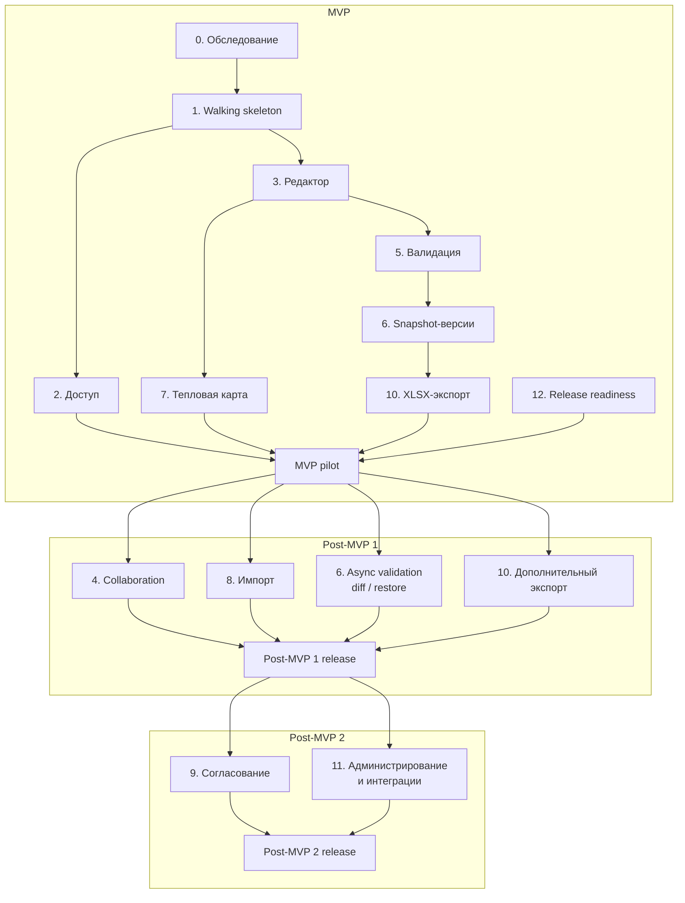

# Целевая архитектура и план реализации

## Назначение документа

Документ связывает целевую архитектуру с реализацией в MVP и двух post-MVP релизах. Начало отдельных epics зависит от обследования внешних систем и нормативных источников.

План задает зависимости и ожидаемые результаты без дат и исполнителей. Состав команды и календарный срок MVP остаются открытыми параметрами.

## Соответствие исходному описанию

| Исходная возможность | Реализация | Релиз |
|---|---|---|
| полный цикл работы с планом | реализуется последовательностью редактор → проверка → версия → согласование → экспорт | MVP + Post-MVP 2 |
| соответствие нормативной документации ВШЭ | фиксированные правила и промежуточная проверка; позднее административное управление правилами | MVP / Post-MVP 2 |
| версионирование | immutable JSONB snapshot по кнопке; позднее diff, restore и асинхронная проверка | MVP / Post-MVP 1 |
| совместное редактирование | REST optimistic locking; позднее presence и live-доставка через STOMP | MVP / Post-MVP 1 |
| выгрузка в различные форматы | один обязательный XLSX; позднее PDF и JSON/XML | MVP / Post-MVP 1 |
| интерактивная визуализация | тепловая карта модульной нагрузки; позднее граф зависимостей | MVP / Post-MVP 1 |
| интеграции с ИС ВШЭ | LMS/IdP для входа; позднее Integration для других ИС | MVP / Post-MVP 2 |

Сокращенный MVP не реализует исходное описание целиком в первом релизе. Целевая архитектура и roadmap покрывают каждую возможность краткого исходного требования без изменения предметного ядра. Автоматическое формирование по стандарту, оптимизационное выравнивание, интеллектуальная замена дисциплин и отчетность план/факт относятся к долгосрочному развитию и не входят в текущий roadmap.

Намеренно сохранены следующие ограничения MVP:

- один экземпляр модульного backend без высокой доступности;
- две среды: `dev` и `production`;
- отсутствие централизованного бизнес-аудита;
- отсутствие массовых операций, нагрузочных и consumer-driven contract tests;
- ручное создание immutable version;
- упрощенное совместное редактирование без CRDT/OT;
- расчет нагрузки по учебным модулям без распределения по преподавателям.

## Состав релизов

| Релиз | Пользовательский результат | Epics |
|---|---|---|
| `MVP` | авторизация, ручной редактор, промежуточная валидация, snapshot-версии, тепловая карта и один XLSX-экспорт | 0-3, 5, базовые части 6, 7 и 10, 12 |
| `Post-MVP 1` | real-time collaboration, безопасный импорт, асинхронная проверка версий, diff/restore и дополнительные экспорты | 4, расширение 6, 8 и 10 |
| `Post-MVP 2` | согласование, административное управление правилами и дополнительные интеграции | 9, 11 |

Целевая архитектура, OpenAPI и модель данных могут содержать контракты следующих релизов. Наличие контракта не означает включение функции в MVP.

## Открытые решения

| ID | Решение | Влияние | Требуется до |
|---|---|---|---|
| `OD-01` | протокол и claims LMS/IdP | блокирует production-аутентификацию | Epic 2 |
| `OD-02` | форматы импорта и примеры реальных файлов | блокирует production-парсеры | Epic 8 |
| `OD-03` | обязательные нормативные документы и правила | блокирует набор production-валидаций | Epic 6 |
| `OD-04` | обязательные экспортные формы | блокирует production-экспорт | Epic 10 |
| `OD-05` | организационная модель доступа | блокирует окончательную RBAC/ABAC policy | Epic 2 |
| `OD-06` | CI/CD, registry и платформа развертывания | блокирует production pipeline | Epic 1 и Epic 12 |
| `OD-07` | предоставление PostgreSQL, Redis и observability; доступность Kafka/MinIO проверяется только при принятии соответствующего proposed ADR | определяет deployment manifests | соответствующий использующий компонент epic |
| `OD-08` | механизм secrets management | блокирует production-развертывание | Epic 12 |
| `OD-09` | антивирус и изоляция парсеров | блокирует безопасный production-импорт | Epic 8 |
| `OD-11` | общий STOMP broker relay | требуется только перед масштабированием backend | после MVP |
| `OD-12` | правила уникальности планов программы и года набора | влияет на ограничения БД и UX создания | Epic 3 |

Открытое решение оформляется ADR, если после сравнения альтернатив меняет технологию, внешний или межпроцессный контракт либо эксплуатационную модель. Ответственный и срок решения назначаются при переносе epic в разработку.

## Стратегия реализации

Работа выполняется вертикальными инкрементами. Каждый инкремент включает необходимые изменения web-клиента, API, backend-модулей, данных, security, telemetry и тестов. Создание всех модульных каркасов отдельной горизонтальной фазой не считается пользовательским инкрементом.

### Первый работающий инкремент

Walking skeleton должен позволять пользователю:

1. войти через тестовый OIDC-compatible IdP;
2. открыть web-приложение через Backend API;
3. создать учебный план с программой, направлением и годом набора;
4. изменить метаданные плана с `ETag`/`If-Match`;
5. перезагрузить страницу и получить сохраненные данные.

Инкремент включает модульный Spring Boot backend, Curriculum, минимальный Identity adapter, PostgreSQL/Flyway, reverse proxy, web-клиент, Docker-образы, `dev`-развертывание, структурированные логи, trace propagation, unit/integration и smoke E2E. Kafka, STOMP и остальные модули подключаются только в использующих их инкрементах.

## Backlog epics

### Epic 0. Обследование и подготовка backlog `[MVP]`

**Зависимости:** отсутствуют.

**Результат:** неизвестные требования получают владельцев, примеры и критерии приемки.

- [ ] Получить примеры учебных планов и определить обязательные форматы импорта.
- [ ] Зафиксировать обязательные экспортные формы.
- [ ] Собрать перечень нормативных документов и владельцев правил.
- [ ] Обследовать LMS/IdP: protocol, issuer, audience, claims, JWKS, logout и тестовый контур.
- [ ] Согласовать организационные области доступа для четырех ролей.
- [ ] Определить правило уникальности планов.
- [ ] Назначить владельцев и сроки открытым решениям `OD-01` - `OD-09`, `OD-11` и `OD-12`.
- [ ] Подготовить тестовые данные без production-персональных данных.

### Epic 1. Инженерная платформа и walking skeleton `[MVP]`

**Зависимости:** решение по структуре репозиториев; временный тестовый IdP допустим.

**Результат:** первый работающий инкремент развернут в `dev`.

- [ ] Создать единый репозиторий backend и web-клиента с едиными правилами версий и code style.
- [ ] Настроить Java 21, Spring Boot, Spring Modulith, ArchUnit, Flyway и сборку OCI-образов.
- [ ] Выделить пакеты Identity, Curriculum, Validation, Versioning и Files с публичными application API.
- [ ] Добавить архитектурные тесты модульных границ и запрета циклических зависимостей.
- [ ] Зафиксировать package-based модули в одном backend build и один развертываемый backend artifact.
- [ ] Добавить архитектурный тест, запрещающий прямой доступ к repository/entity другого модуля.
- [ ] Запретить cross-module write transaction; многошаговые процессы оформлять явными состояниями и идемпотентными командами.
- [ ] Создать web-shell и маршрутизацию через Backend API.
- [ ] Реализовать минимальный Curriculum и миграции таблицы планов.
- [ ] Реализовать создание, чтение и изменение метаданных плана.
- [ ] Добавить `ETag`, `If-Match` и единый error envelope.
- [ ] Подключить тестовый OIDC-compatible IdP и проверку access token.
- [ ] Настроить correlation ID, JSON logs, базовые метрики и traces.
- [ ] Подготовить локальный запуск и развертывание `dev`.
- [ ] Добавить unit-, Testcontainers integration- и Playwright smoke-тесты.

### Epic 2. Идентификация, роли и области доступа `[MVP / Post-MVP 2]`

**Зависимости:** `OD-01`, `OD-05`, Epic 1.

**Результат:** пользователи видят и изменяют только разрешенные планы согласно роли и организационной области.

- [ ] Реализовать production adapter LMS/IdP.
- [ ] Сопоставить внешнюю identity с локальным профилем пользователя.
- [ ] В MVP реализовать роли методиста и администратора.
- [ ] В Post-MVP 2 добавить роли заведующего и директора.
- [ ] Реализовать resource-level authorization для программы и плана.
- [ ] Добавить административное назначение локальных ролей, если роли не приходят из LMS.
- [ ] Защитить management endpoints и публичные application API модулей.
- [ ] Добавить негативные тесты `401`, `403`, `404` и BOLA.

### Epic 3. Доменное ядро и редактор плана `[MVP]`

**Зависимости:** Epic 1, решение `OD-12`.

**Результат:** методист редактирует структуру учебного плана и нагрузку по модулям.

- [ ] Реализовать справочники программ, направлений и дисциплин.
- [ ] Реализовать блоки учебного плана.
- [ ] Реализовать включение каталожной дисциплины в план.
- [ ] Реализовать четыре учебных модуля на год через `study_periods`.
- [ ] Реализовать нагрузки и формы контроля дисциплины по модулю.
- [ ] Реализовать связи пререквизитов и запрет циклов.
- [ ] Реализовать optimistic locking для каждой изменяемой сущности.
- [ ] Реализовать REST resync плана через conditional GET.
- [ ] Добавить транзакционные ограничения и индексы из модели данных.
- [ ] Покрыть доменные правила unit- и integration-тестами.

### Epic 4. Совместное редактирование `[Post-MVP 1]`

**Зависимости:** Epic 3; Redis требуется только перед запуском нескольких экземпляров backend.

**Результат:** несколько пользователей видят presence и подтвержденные изменения плана в real time.

- [ ] Опубликовать after-commit application event `curriculum.updated` с revision и correlation metadata.
- [ ] Реализовать Collaboration и STOMP endpoint `/ws`.
- [ ] Реализовать авторизацию CONNECT, SUBSCRIBE и SEND.
- [ ] Реализовать presence с TTL; использовать Redis при масштабировании backend.
- [ ] Реализовать дедупликацию событий и обнаружение пропущенной revision на клиенте.
- [ ] Реализовать reconnect с backoff и обязательный REST resync после восстановления STOMP.
- [ ] Добавить E2E-сценарий двух браузерных контекстов и конфликт `If-Match`.

### Epic 5. Каркас нормативных правил и промежуточная валидация `[MVP / Post-MVP 2]`

**Зависимости:** Epic 3; для production-набора правил требуется `OD-03`.

**Результат:** методист проверяет рабочую ревизию и получает `ACCEPT`, `WARNING` или `ERROR` по сущностям.

- [ ] Реализовать Validation и таблицы запусков/результатов.
- [ ] В MVP загрузить фиксированный versioned набор утвержденных правил через миграции.
- [ ] В Post-MVP 2 реализовать административное изменение правил.
- [ ] Реализовать синхронный запуск проверки текущей ревизии.
- [ ] Сохранять `source_revision` и помечать результат устаревшим после изменения плана.
- [ ] Реализовать привязку замечания к конкретной сущности.
- [ ] Реализовать первые структурные и нагрузочные правила.
- [ ] Реализовать outcome `ERROR > WARNING > ACCEPT`.
- [ ] Добавить unit-тесты каждого правила и интеграционные тесты запуска.

### Epic 6. Версионирование и асинхронная проверка `[MVP / Post-MVP 1]`

**Зависимости:** Epics 3 и 5, ADR-0012; Kafka и ADR-0011 требуются только при межпроцессной обработке.

**Результат MVP:** пользователь сохраняет и просматривает immutable snapshot-версии с синхронным результатом проверки.

**Результат Post-MVP 1:** пользователь сравнивает и восстанавливает версии, а проверка выполняется асинхронно.

- [ ] `[MVP]` Реализовать канонический JSONB snapshot и `content_hash`.
- [ ] `[MVP]` Реализовать сохранение, синхронную проверку и чтение версии.
- [ ] `[MVP]` Добавить тесты неизменяемости snapshot.
- [ ] `[Post-MVP 1]` Добавить статус `PENDING` и сохранять задание проверки в DB-backed очереди одной транзакцией с версией.
- [ ] `[Post-MVP 1]` Реализовать worker с `FOR UPDATE SKIP LOCKED`, lease, retry/backoff и восстановлением зависших заданий.
- [ ] `[Post-MVP 1]` Реализовать идемпотентное обновление статуса и ручной replay.
- [ ] `[Post-MVP 1]` Реализовать `RUNNING`, `COMPLETED`, `FAILED`, `UNAVAILABLE` и replay.
- [ ] `[Post-MVP 1]` Реализовать структурированный diff по стабильным UUID сущностей.
- [ ] `[Post-MVP 1]` Реализовать восстановление snapshot как новой рабочей ревизии.
- [ ] `[Post-MVP 1]` Доставлять персональное STOMP-уведомление о завершении проверки.

### Epic 7. Тепловая карта нагрузки `[MVP]`

**Зависимости:** Epics 3 и 5.

**Результат:** пользователь видит распределение нагрузки по модулям и рекомендации по отклонениям.

- [ ] Определить агрегаты нагрузки для плана, года, модуля и дисциплины.
- [ ] Реализовать read model или оптимизированные запросы агрегирования.
- [ ] Реализовать API данных визуализации.
- [ ] Реализовать интерактивную тепловую карту в web-клиенте.
- [ ] Связать ячейки карты с дисциплинами и результатами правил.
- [ ] Добавить состояния отсутствующих, неполных и устаревших данных.
- [ ] Добавить unit-тесты расчетов и E2E-сценарий визуализации.

### Epic 8. Безопасный импорт через staging `[Post-MVP 1]`

**Зависимости:** Epic 3, `OD-02`, `OD-09`.

**Результат:** методист загружает файл, исправляет результаты распознавания и атомарно применяет импорт.

- [ ] Реализовать multipart upload через backend с лимитом 50 MiB.
- [ ] Реализовать изолированный временный каталог, quota и очистку в `finally` и при старте.
- [ ] Реализовать проверки magic bytes, MIME, SHA-256 и лимитов распаковки.
- [ ] Интегрировать антивирус и изолированное выполнение парсеров.
- [ ] Реализовать parser adapter для первого обязательного формата.
- [ ] Сохранить нормализованный JSON staging payload и issues.
- [ ] Реализовать preview и административную корректировку распознанных данных.
- [ ] Реализовать `ERROR`/`WARNING` и явное подтверждение warning.
- [ ] Реализовать синхронное атомарное применение staging payload.
- [ ] Добавить вредоносные и поврежденные файлы в security regression suite.

### Epic 9. Согласование `[Post-MVP 2]`

**Зависимости:** Epics 2 и 6.

**Результат:** сохраненная и проверенная версия проходит маршрут методист - заведующий - директор.

- [ ] Реализовать шаблон маршрута и approval instance.
- [ ] Блокировать запуск до `COMPLETED` и при outcome `ERROR`.
- [ ] Требовать acknowledgement для `WARNING`.
- [ ] Реализовать решения approve, reject и return for revision.
- [ ] Реализовать комментарии к версии и сущности snapshot.
- [ ] Гарантировать неизменяемость согласуемой версии при продолжении работы над планом.
- [ ] Реализовать role/resource authorization каждого шага.
- [ ] Реализовать уведомления участников и E2E-сценарий полного маршрута.

### Epic 10. Экспорт `[MVP / Post-MVP 1]`

**Зависимости:** Epic 6, `OD-04`.

**Результат MVP:** пользователь экспортирует сохраненную версию в один обязательный XLSX-формат.

**Результат Post-MVP 1:** доступны дополнительные PDF и машиночитаемые форматы.

- [ ] `[MVP]` Реализовать renderer первого обязательного XLSX-формата.
- [ ] Передавать результат потоковым HTTP-ответом с безопасным `Content-Disposition`.
- [ ] Ограничить timeout, параллелизм и максимальный размер ответа.
- [ ] Защитить табличные форматы от formula injection.
- [ ] `[MVP]` Реализовать повторяемость экспорта одной версии.
- [ ] `[Post-MVP 1]` Добавить PDF и утвержденный JSON/XML-формат.
- [ ] Добавить golden-file или структурные тесты результата.

### Epic 11. Администрирование и интеграции `[Post-MVP 2]`

**Зависимости:** Epics 2, 3, 5 и результаты обследования внешних систем.

**Результат:** администратор управляет справочниками, правилами и состоянием интеграций.

- [ ] Реализовать административные экраны справочников.
- [ ] Реализовать управление нормативными rule tables.
- [ ] Реализовать Integration и anti-corruption adapters.
- [ ] Реализовать ручной запуск и просмотр статуса синхронизации LMS.
- [ ] Реализовать retry и безопасную обработку частичных ошибок интеграции.
- [ ] Добавить технические метрики и runbook интеграции.

### Epic 12. Production readiness и пилот `[MVP, затем каждый релиз]`

**Зависимости MVP:** Epics 0-3, 5, базовые части 6, 7 и 10, а также инфраструктурные решения `OD-06` - `OD-08`.

**Результат:** согласованный объем MVP развернут в `production` и готов к пилотной эксплуатации.

- [ ] Подготовить production manifests и environment configuration.
- [ ] Настроить secrets, TLS, network restrictions и backup jobs.
- [ ] Настроить dashboards, alerts и runbooks.
- [ ] Проверить восстановление PostgreSQL и очистку временного volume после перезапуска.
- [ ] Выполнить полный E2E, DAST и file-security regression.
- [ ] Проверить миграции на копии данных сопоставимого размера.
- [ ] Проверить rollback на предыдущий image digest.
- [ ] Провести ручной security review и устранить блокирующие findings.
- [ ] Обучить пилотных пользователей и определить канал поддержки.
- [ ] Зафиксировать baseline метрик для последующего определения SLO/RTO/RPO.

## Зависимости epics

После Epic 3 часть работ может идти параллельно. Фактическая параллельность определяется составом команды, которого пока нет.

## Облегченная матрица трассировки

| Область требований | Релиз | Основные компоненты | Контракты/данные | Проверка | Epic |
|---|---|---|---|---|---|
| роли и доступ | MVP / Post-MVP 2 | Spring Security, Identity, прикладные модули | bearer token, organizational scope | BOLA/RBAC integration tests | 2 |
| редактор | MVP | Curriculum, web | `/curricula/**`, curriculum schema | unit, PostgreSQL integration, E2E | 3 |
| совместная работа | Post-MVP 1 | Curriculum, Collaboration | STOMP changes/presence, revision | two-client E2E, reconnect | 4 |
| промежуточная валидация | MVP | Validation, Curriculum | `validation-runs`, source revision | rule unit tests, integration | 5 |
| версии | MVP / Post-MVP 1 | Versioning, Validation | versions, JSONB snapshot, application events | immutability/retry integration | 6 |
| визуализация | MVP | Curriculum/Validation read model, web | workload aggregates | calculation unit, E2E | 7 |
| импорт | Post-MVP 1 | Files, Curriculum | multipart upload, staging JSON | parser/security/E2E | 8 |
| согласование | Post-MVP 2 | Workflow, Versioning | approval instances/decisions | state and authorization tests | 9 |
| экспорт | MVP / Post-MVP 1 | Files | streaming export response | golden-file, authorization | 10 |
| интеграции | Post-MVP 2 | Integration | LMS adapters, sync jobs | stub integration tests | 11 |
| эксплуатация | каждый релиз | backend и platform components | telemetry, health, backups | smoke, restore, rollback | 12 |

Детальная связь отдельных нормативных правил с документами ВУЗа создается после закрытия `OD-03` и хранится вместе с каталогом validation rules.

## Definition of Done для backlog

Каждая задача или story считается завершенной, когда выполнены применимые условия:

- acceptance criteria согласованы и проверены;
- код прошел review минимум одним разработчиком;
- unit- и integration-тесты добавлены и проходят раздельно;
- затронутый Playwright-сценарий обновлен;
- миграции проверены на чистой и существующей БД;
- OpenAPI, события и архитектурная документация обновлены;
- observability и безопасная обработка ошибок добавлены;
- отсутствуют новые непринятые critical/high security findings;
- изменение развернуто и smoke-tested в `dev`.

## Критерий завершения MVP

MVP считается готовым к пилоту, когда завершены Epics 0-3, 5, 7, MVP-части Epics 6 и 10, а также необходимые задачи Epic 12. Обязательны закрытые блокирующие решения, E2E- и security-проверки, подтвержденное восстановление данных и эксплуатационные runbooks. Epics 4, 8, 9 и 11 не блокируют выпуск MVP. Календарная дата и состав команды остаются открытыми параметрами планирования.
